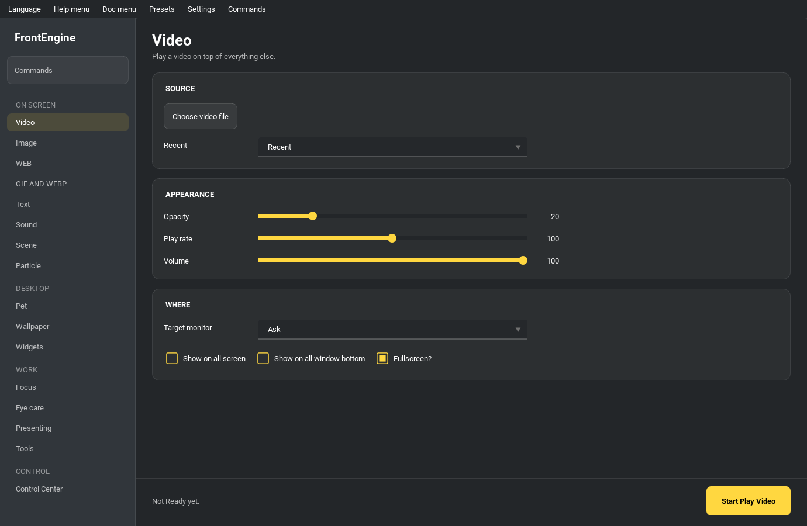

# FrontEngine

<p align="center">
  <a href="../README.md">English</a> ·
  <a href="README_zh-TW.md">繁體中文</a> ·
  <a href="README_zh-CN.md">简体中文</a> ·
  <a href="README_ja.md">日本語</a> ·
  <a href="README_ko.md">한국어</a> ·
  <a href="README_es.md">Español</a> ·
  <a href="README_fr.md">Français</a> ·
  <a href="README_de.md">Deutsch</a> ·
  <strong>Português (BR)</strong> ·
  <a href="README_ru.md">Русский</a>
</p>

[](https://github.com/JeffreyChen-SteamProjects/FrontEngine/actions/workflows/ci.yml)
[](https://pypi.org/project/frontengine/)
[](https://pypi.org/project/frontengine/)

**Coloque qualquer coisa sobre a sua tela — ou por baixo dela.**

O FrontEngine é um aplicativo de sobreposição para desktop. Vídeo, imagens,
GIFs, páginas web, texto, partículas, som e um mascote animado podem ser
colocados sobre todas as outras janelas (com clique passante, então o que está
por baixo continua funcionando), ou atrás delas como um papel de parede ao vivo.
Em torno disso há um conjunto de ferramentas para a própria tela: filtros de
conforto visual, anotação em apresentações, medição e captura, máscaras de foco
e widgets de área de trabalho.

[Apoie este projeto na Steam](https://store.steampowered.com/app/2793470/FrontEngine/)
 · [Documentação](https://frontengine.readthedocs.io/en/latest/)
 · [Assista a uma demonstração](https://youtu.be/fewogcb3b8Y)



---

## Instalação

Python **3.10+**. O Windows 10/11 é o alvo principal; o macOS e o Linux executam
o aplicativo, com as diferenças de plataforma listadas em [Suporte de plataforma](#suporte-de-plataforma).

```bash
pip install frontengine

frontengine                    # or: python -m frontengine
frontengine --preset "Work"    # apply a saved preset on launch
```

Binários pré-compilados para Windows estão na
[página de Releases](https://github.com/JeffreyChen-SteamProjects/FrontEngine/releases),
e a versão da Steam entrega o mesmo aplicativo com suporte à Workshop.

> **Saindo.** As sobreposições podem cobrir a tela inteira, incluindo a própria
> janela do FrontEngine, então há duas saídas de emergência que não precisam do
> mouse: `Ctrl+Shift+F12` fecha todas as sobreposições, e **F12 encerra o
> aplicativo por completo** de qualquer lugar (Windows; macOS exige permissão de Acessibilidade — veja *Ajuda →
> Como forçar o fechamento*).

---

## O que ele coloca na tela

A barra lateral agrupa as páginas conforme a finalidade delas. Esta seção segue
essa organização.

### Na tela

Sobreposições de mídia. Cada uma escolhe seu monitor (ou abrange todos eles),
lembra onde você a arrastou e tem sua própria opacidade.

- **Vídeo** — com volume, taxa de reprodução e repetição.
- **Imagem** — uma única figura, uma pasta como apresentação de slides, ou um
  **quadro de referência**: várias imagens em uma tela, cada uma arrastável, com
  o quadro inteiro podendo receber zoom e ser deslocado.
- **Web** — uma URL ou um arquivo HTML local, opcionalmente interativo. O **modo
  painel** alterna por uma lista de URLs, para que um display de parede possa
  percorrer páginas por uma tecla de atalho ou um temporizador.
- **GIF / WebP** — animações com velocidade ajustável.
- **Texto** — fonte, cor, contorno, alinhamento e um letreiro rolante, mostrando
  ou uma cadeia fixa ou uma **fonte ao vivo**: relógio, data, contagem
  regressiva, cronômetro, carga do sistema ou o clima. As fontes ao vivo usam um
  modelo `{field}`, e a página lista os campos que cada uma oferece.
- **Som** — reprodução de música e efeitos WAV de baixa latência.
- **Cena** — combine vários dos itens acima em uma única composição descrita por
  um documento JSON que você pode salvar e compartilhar.
- **Partícula** — um efeito de partículas em OpenGL.

<details>
<summary>Capturas de tela (os GIFs podem levar um momento para carregar)</summary>

| GIF | WebP |
| --- | --- |
|  |  |

| Vídeo | Site |
| --- | --- |
|  |  |

</details>

### Área de trabalho

**Mascote de desktop** — um sprite animado que vive na sua área de trabalho.

- O cuidado salva energia e modos de brincar/trabalhar/descansar por identidade, preservando UUID e estatísticas da versão 1. O menu do sprite adiciona cumprimentos, carinho e escovação. Ações com tempo só recompensam a conclusão; animais saciados recusam comida e repetições exigem uma pausa. O cuidado acompanha o tempo ativo, sem acumular tempo oculto ou offline. Puppet compartilha sessão e regras de alimentação; respostas nativas dependem do runtime e do modelo. 

- **Sprites** — um único GIF/WebP/PNG, ou uma pasta *pet pack* cujos nomes de
  arquivo mapeiam para estados: `walk`, `idle`, `sleep`, `climb`, `fall`, `drag`
  (um estado ausente recai em `walk`). Um `pet.json` opcional define tamanho,
  velocidade e se ele pode escalar, falar ou sentar em janelas.
- **Comportamento** — anda pelo chão com gravidade (arremesse-o e ele quica),
  vagueia livremente, ou persegue o cursor. Mascotes de chão escalam as bordas
  da tela e ficam de pé na borda superior de outras janelas.
- **Vida** — humor, saciedade e um nível de afeição que persistem entre
  execuções. Ele cresce conforme sobe de nível, fala em balões de fala, tira
  cochilos enquanto você está ausente e avisa sobre bateria fraca.
- **Interação** — arraste-o, clique com o botão direito para clonar / alimentar
  / definir um lembrete, e **solte um arquivo sobre ele**: uma imagem ou pet
  pack vira sua nova aparência, qualquer outra coisa é comida. O que ele come
  importa — um arquivo compactado é um banquete, música o anima mais do que o
  enche, um documento é uma refeição modesta, um binário é difícil demais de
  mastigar.
- **Pega-pega** — com dois ou mais mascotes na tela, marque *Brincar de pega-pega
  entre si* e um se torna o "pegador": ele caminha em direção ao vizinho mais
  próximo enquanto os outros correm na direção oposta, e pegar alguém passa a
  vez adiante.
- **Reage ao som** — o mascote pulsa com a saída dos seus alto-falantes, ou com
  o seu **microfone** para que se mexa enquanto você fala. Ambos leem apenas o
  *medidor* de saída — um número, não áudio. Os picos são suavizados com uma
  janela RMS e um envelope de ataque rápido/decaimento lento, para que a
  pulsação respire em vez de tremular. Com vários monitores, cada mascote segue
  o ponto de saída de áudio correspondente à sua própria tela.
- **Temporizador de foco** — um pomodoro na mesma página, anunciado pelo
  mascote: ele avisa quando o foco termina e quando a pausa acabou.
- **Chat** — o mascote pode responder você por meio do Claude quando
  `ANTHROPIC_API_KEY` está definido. Desativado a menos que você o habilite;
  veja [O que sai da máquina](#o-que-sai-da-máquina).

**Papel de parede** — reproduza uma pasta de imagens e animações *por baixo* de
cada janela. Cada monitor aponta para sua própria pasta com seu próprio
temporizador, embaralhada ou lida recursivamente, e pode pulsar com o nível dos
alto-falantes. Uma segunda pasta pode assumir durante as horas de silêncio.

**Widgets** — quatro coisas que ficam na área de trabalho:

- **Espectro de áudio** — barras ou um anel, bandas espaçadas em escala
  logarítmica, suavizadas com um seguidor de ataque rápido/decaimento lento e
  marcadores de pico que descem gradualmente.
- **Tocando agora** — a faixa atual dos controles de mídia do Windows quando os
  bindings opcionais `winsdk` estão instalados; caso contrário, o nome do
  aplicativo que está de fato produzindo som.
- **Monitor do sistema** — CPU, memória, disco, bateria e taxa de transferência
  de rede como pequenos sparklines; marque as linhas que você quiser. Uma média
  esconde uma paralisação; uma linha não. Uma linha oculta continua registrando,
  então reativá-la mostra o que aconteceu nesse meio-tempo.
- **Notas adesivas** — cartões editáveis acima de cada janela, mantendo seu
  texto, cor e posição entre sessões.

### Trabalho

**Foco** — duas sobreposições para quando a tela compete com o seu trabalho.
*Escurecer janelas de fundo* sombreia tudo, exceto a janela em que você está
trabalhando, com intensidade ajustável. *Cobrir uma distração* mascara uma faixa
da tela: a barra de tarefas, um canto de notificações, uma borda, ou tudo. Ambas
deixam os cliques passar, então o que elas cobrem continua funcionando — apenas
para de puxar o seu olhar.

**Cuidado com a tela** — para sessões longas diante da tela:

- **Filtro de cor** — sete tonalidades, do quente passando por âmbar e rosa até
  o cinza, com intensidade ajustável.
- **Régua de leitura** — escurece a página e deixa uma faixa clara que segue o
  cursor.
- **Lembrete de pausa** — a regra 20-20-20, com uma sobreposição de descanso
  quando o intervalo se completa.
- **Simulação de visão de cores** — protanopia, deuteranopia, tritanopia e
  acromatopsia com severidade ajustável, usando o modelo de Machado et al.
  (2009). Diferentemente das outras sobreposições, esta é opaca, porque mostrar
  o que outra pessoa vê significa repintar a tela em vez de matizá-la.

**Apresentação** — para demonstrações, aulas e gravações:

- **Anotação** — desenhe sobre a tela com uma caneta, um marca-texto ou uma
  borracha, com desfazer e limpar.
- **Efeitos de cursor** — um anel ao redor do ponteiro, uma ondulação ao clicar
  e um holofote que escurece todo o resto.
- **Exibição de teclas** — mostra o que você acabou de pressionar, e qual botão
  do mouse você clicou, para que os espectadores possam acompanhar; some após
  alguns segundos. Escolha onde o painel fica e o tamanho do texto, e desative os
  cliques do mouse separadamente.
- **Lupa** — uma visão ampliada da área ao redor do cursor.
- **Quadro branco** — uma tela infinita: arraste para deslocar, role para dar
  zoom, salve o que você desenhou. Os traços vivem em coordenadas da tela, então
  deslocar e dar zoom os deixa onde eles pertencem.
- **Congelar** — fixe o quadro atual de um monitor para que você possa continuar
  trabalhando atrás de uma imagem parada. `Ctrl+Shift+F7` a libera, o que importa
  porque a imagem congelada cobre o botão que faria isso.

**Ferramentas** — medição, captura e manuseio de janelas:

- **Conta-gotas de cor / régua de pixels / transferidor** — clique para
  amostrar ou medir; o resultado vai direto para a área de transferência como
  `#rrggbb`, `rgb(...)`, `hsl(...)` ou uma propriedade personalizada de CSS.
- **Captura de região** — arraste para delimitar uma área; ela vai para a área
  de transferência, pode ser salva em um arquivo, ou **fixada** por cima como uma
  cópia flutuante com zoom.
- **Gravar área** — Gravação: selecione uma área e o GIF o AVI de destino antes de iniciar a captura. Cancelar não inicia a gravação. Uma thread em segundo plano escreve os quadros incrementalmente; a fila é limitada a três quadros e 64 MiB. Um quadro grande demais é recusado. Uma fila cheia pula capturas e preserva o tempo decorrido na reprodução. Taxa, limites de duração e quadros e inserção da câmera permanecem. Parar finaliza de forma assíncrona; o arquivo substitui o destino atomicamente somente após sucesso. Cancelamento e erros removem o temporário e preservam o destino existente.
- **Câmera** — a sua webcam em um círculo, caixa arredondada ou retângulo,
  exibida localmente e nunca gravada. Qualquer entrada de vídeo funciona,
  incluindo placas de captura, e a lista de dispositivos se atualiza sem
  reiniciar, já que as placas normalmente são conectadas enquanto o aplicativo
  já está em execução.
- **Câmera virtual** — envie uma região, com sobreposições e tudo, como uma
  webcam que o Zoom, o Teams ou o Discord possam selecionar como sua fonte de
  vídeo. Precisa do pacote opcional `pyvirtualcam` e de um driver de câmera
  virtual (o OBS instala um); sem um deles, o botão diz isso em vez de falhar
  silenciosamente.
- **Ler texto** — Texto na tela: Ferramentas → Ler texto usa primeiro OCR local: Windows.Media.Ocr no Windows, Vision no macOS ou Tesseract instalado com dados de idiomas. Extração local não precisa de consentimento para a nuvem nem ANTHROPIC_API_KEY; um resultado vazio bem-sucedido não envia captura. Tradução e perguntas podem enviar texto reconhecido à Anthropic somente com consentimento separado para texto e sua chave. Captura como alternativa após falha local exige consentimento próprio para imagens e a chave. O resultado mostra mecanismo e erros; ali é possível retirar o consentimento.
- **Fixar uma janela** — mantenha a janela de outro programa por cima, ou
  atenue-a, enquanto você trabalha diante dela. Apenas o empilhamento e a
  opacidade são tocados, nunca o conteúdo da janela.
- **Réplica de janela** — uma pequena cópia ao vivo sempre no topo de outra
  janela, para que você possa acompanhar uma renderização ou um chat enquanto
  ele está soterrado.
- **Layouts de janela** — salve onde cada janela fica e recoloque-as depois. As
  janelas são identificadas pelo título; uma que não esteja na tela é ignorada
  em vez de ser adivinhada.

---

## Controlando tudo de uma vez

A página **Central de controle** alcança cada sobreposição em cada página, seja
qual for a aba que a abriu: ocultar, mostrar, fechar, silenciar, travar,
redefinir posições, ajustar a opacidade em passos, e aplicar um **nível de
qualidade** (alto / equilibrado / economia) que limita a taxa de atualização de
cada sobreposição e reduz sua resolução de renderização. Ela também carrega um
fundo de chroma-key para o OBS, uma opção *Ocultar da captura*, o painel de logs
e **Fixar nesta área de trabalho** — as sobreposições saem de cena quando você
troca de área de trabalho virtual e retornam quando você volta. Desafixar traz
de volta o que quer que ela tenha guardado.

Teclas de atalho globais padrão, todas reconfiguráveis em **Configurações →
Teclas de atalho**:

| Atalho | Ação |
| --- | --- |
| `Ctrl+Shift+F12` | Fechar todas as sobreposições |
| `Ctrl+Shift+F11` / `F10` | Ocultar / mostrar todas as sobreposições |
| `Ctrl+Shift+F9` | Silenciar tudo |
| `Ctrl+Shift+↑` / `↓` | Aumentar / diminuir opacidade |
| `Ctrl+Shift+L` | Travar ou destravar (clique passante vs. arrastável) |
| `Ctrl+Shift+→` | Próxima página do painel |
| `Ctrl+Shift+F8` | Mostrar a folha de atalhos na tela |
| `Ctrl+Shift+F7` | Congelar / descongelar a tela |
| `Ctrl+Shift+F6` / `F5` / `F4` | Reproduzir/pausar mídia, próxima e faixa anterior |
| `Ctrl+Shift+F3` | Mover a janela em primeiro plano para o próximo monitor |
| `F12` | Sair imediatamente (Windows / macOS*) |

O transporte de mídia envia as teclas de mídia do sistema, então alcança
qualquer reprodutor que as escute. Mover uma janela mantém suas proporções em
vez de encaixá-la, que é o que o próprio `Win+Shift+Arrow` do Windows faz.

As mesmas ações — e nada além delas — são o que os controles remotos acionam:

- **Seu telefone** (Configurações → Controle remoto) — o FrontEngine serve uma
  pequena página na sua rede local; abra o link em um telefone e os botões
  acionam essas ações.
- **Um controlador MIDI** — Pressione Learn, mova um botão ou pad e vincule-o. Windows usa winmm integrado; macOS usa CoreMIDI com o extra macos. O botão dispara uma vez no topo; soltar um pad não conta como outro pressionamento.

---

## Predefinições e automação

As **Predefinições** capturam as configurações de todas as páginas de uma vez.
Salve, carregue, exclua, exporte e importe-as no menu **Predefinições**, aplique
uma na inicialização, ou restaure a sessão anterior automaticamente. Uma
predefinição pode ser exportada como um **pacote** — um zip que carrega a mídia
que ela referencia — para que abra em uma máquina que não tem esses arquivos.

Coisas que então decidem por si mesmas, todas a partir do menu **Configurações**.
A pausa inteligente é a única que já vem ligada; todo o resto fica desligado até
você acioná-lo.

| | |
| --- | --- |
| **Regras** | *"Quando estas condições se mantiverem, faça isto."* Combine um dia da semana, uma faixa de horário e qual aplicativo está em foco, então aplique uma predefinição, oculte/mostre/feche as sobreposições, ou defina a qualidade. Uma condição em branco significa "qualquer", e uma regra é executada **uma vez** quando suas condições começam a se manter, em vez de repetidamente enquanto se mantêm. Este é o único lugar onde as condições se compõem; as linhas abaixo conhecem cada uma um único tipo. |
| **Pausa inteligente** | Recolha as sobreposições enquanto um aplicativo em tela cheia estiver rodando, enquanto a máquina estiver na bateria, ou enquanto um aplicativo nomeado estiver em foco. *(Ligada por padrão, para a regra de tela cheia.)* |
| **Perfis de aplicativo** | Aplique uma predefinição quando você mudar para um determinado aplicativo. |
| **Agenda de predefinições** | Aplique uma predefinição em dias da semana escolhidos, em um horário definido. |
| **Agenda de tema** | Alterne entre um tema de dia e um de noite pelo relógio. |
| **Modo sinalização** | Alterne uma lista de predefinições em um temporizador com a janela principal guardada, para uma máquina deixada em execução como display. |
| **Protetor de tela** | Após um limite de inatividade, exiba o vídeo / imagem / GIF / partícula / página web que você escolheu, e retire-o quando você voltar. |
| **Lembretes** | A cada N minutos, ou uma vez por dia em um horário definido, mostrados como um aviso que se fecha sozinho. |
| **Manter ativo** | Impeça o display de dormir enquanto as sobreposições estiverem ativas. |
| **Iniciar com o sistema** | Iniciar ao fazer login. |
| **Tempo de tela** | Quais aplicativos estiveram em foco e por quanto tempo, com um detalhamento diário e um resumo de sete dias. Ele pausa enquanto você está longe do teclado, mantém no máximo 60 dias, e limpar exclui o próprio arquivo. |
| **Histórico da área de transferência** | Pesquise o que você copiou e fixe as frases que você reutiliza. As áreas de transferência frequentemente guardam senhas, então isto é mantido **apenas na memória** a menos que você marque separadamente "manter entre sessões". |

---

## Idiomas

Sete: English, 繁體中文, 简体中文, Deutsch, Русский, Français, Italiano.

Escolha um no menu **Idioma** e a interface muda **imediatamente** — sem
reiniciar. O que quer que você tivesse aberto permanece aberto: as sobreposições
continuam rodando, e as configurações de cada página são deixadas exatamente
como estavam. Em uma instalação da Steam, a primeira inicialização segue o
próprio idioma do cliente Steam.

---

## Notas de privacidade e plataforma

### O que sai da máquina

Tudo no FrontEngine é local, a menos que esteja nesta lista. Há quatro exceções,
todas por opção do usuário (opt-in):

| Recurso | Para onde vai | Proteção |
| --- | --- | --- |
| **Ler texto** (Ferramentas) | Anthropic API | Texto na tela: Ferramentas → Ler texto usa primeiro OCR local: Windows.Media.Ocr no Windows, Vision no macOS ou Tesseract instalado com dados de idiomas. Extração local não precisa de consentimento para a nuvem nem ANTHROPIC_API_KEY; um resultado vazio bem-sucedido não envia captura. Tradução e perguntas podem enviar texto reconhecido à Anthropic somente com consentimento separado para texto e sua chave. Captura como alternativa após falha local exige consentimento próprio para imagens e a chave. O resultado mostra mecanismo e erros; ali é possível retirar o consentimento. |
| **Chat do mascote** | Sua mensagem vai para a API da Anthropic | Mesma chave, mesma regra; desligado por padrão. |
| **Clima** (fonte de texto) | As coordenadas vão para o Open-Meteo | Sem chave, sem conta, sem dados identificáveis; apenas o que você digitou como localização. |
| **Controle remoto por telefone** | HTTPS | Controle por telefone: Configurações → Controle remoto usa apenas HTTPS, um novo token a cada início e uma lista fixa de ações. O telefone não confia automaticamente no certificado autoassinado. Exporte o certificado público e compare a impressão SHA-256 exibida antes de importar ou confiar nas configurações do telefone/navegador. A chave privada fica na pasta de dados do usuário. Mudança de IP, expiração ou regeneração podem exigir confiar em um novo certificado. Falha ao iniciar TLS não volta para HTTP. |

Os recursos de áudio leem apenas um **medidor** de saída — um único número —
exceto o espectro, que precisa de amostras reais para calcular frequências e
assim captura o fluxo de saída do sistema. Essas amostras são analisadas na
memória, nunca gravadas em disco ou enviadas para lugar algum, e a captura para
no momento em que você para o espectro.

Plugins: ativar o carregamento não autoriza um plugin. plugin.json ou um sidecar para arquivo único declara versão, identidade, entrada e capacidades; a aprovação é verificada antes do import Python e vinculada ao resumo do conteúdo. Mudanças no código ou declaração exigem nova aprovação; plugins antigos precisam de confiança total explícita. Configurações permite revogar aprovações; reinicie para descarregar código ativo. Plugins Python continuam com todos os privilégios do aplicativo: declaração e consentimento não são sandbox do sistema operacional.

### Privacidade em compartilhamento de tela

Suas sobreposições são para você, não para as pessoas com quem você está
compartilhando. Em **Configurações → Privacidade em compartilhamento de tela**,
o FrontEngine pode retirá-las da captura enquanto um aplicativo de reunião
estiver aberto:

- **Elas permanecem na sua própria tela.** Apenas a cópia capturada fica em
  branco — isto usa o `WDA_EXCLUDEFROMCAPTURE` do Windows, uma flag de nível de
  SO que aplicativos de conferência e gravadores respeitam.
- **As máscaras são a exceção.** Uma máscara de distração existe para cobrir
  algo, então ela deliberadamente permanece visível na captura.
- **O gatilho é a sua lista.** O Windows não tem uma API confiável de "estou
  sendo capturado", então ele observa os títulos de janela que você nomeia — o
  que também pega uma reunião realizada em uma aba de navegador, onde o
  executável é apenas o navegador.

Há também um botão manual *Ocultar da captura* na central de controle.

> Isto é privacidade, não segurança: derrota o caminho comum de captura, e nunca
> esconde nada da pessoa sentada à mesa.

### Suporte de plataforma

Tudo o que não estiver listado aqui funciona nas três plataformas.

| Recurso | Windows | macOS | Linux |
| --- | :---: | :---: | :---: |
| Sobreposições e interface comuns | ✅ | ✅ | Qt / X11 |
| Áudio do sistema, espectro e microfone | ✅ | backend* | Pulse† |
| Metadados da reprodução atual | ✅ | — | — |
| Geometria, disposição e mudança de monitor | ✅ | backend* | X11† |
| Cópia de janela ao vivo | ✅ | backend* | — |
| Janelas alheias: primeiro plano / opacidade | ✅ | — | X11† |
| Excluir sobreposições da captura | ✅ | — | — |
| Controle MIDI | ✅ | backend* | — |
| Teclas de mídia | ✅ | backend* | — |
| Área virtual / seleção de Space | ✅ | — | — |
| Saída de emergência F12 | ✅ | backend* | — |
| Mascote sobre outras janelas | ✅ | backend* | wmctrl |

* As entradas macOS «backend» exigem o extra macos, macOS 13+ e as permissões indicadas. Descrevem caminhos públicos implementados, não validação nativa neste computador Windows; veja as notas abaixo.

Onde um recurso não pode funcionar, o botão diz isso em vez de falhar
silenciosamente.

---

## Execução, privacidade e interoperabilidade

Gravação: selecione uma área e o GIF o AVI de destino antes de iniciar a captura. Cancelar não inicia a gravação. Uma thread em segundo plano escreve os quadros incrementalmente; a fila é limitada a três quadros e 64 MiB. Um quadro grande demais é recusado. Uma fila cheia pula capturas e preserva o tempo decorrido na reprodução. Taxa, limites de duração e quadros e inserção da câmera permanecem. Parar finaliza de forma assíncrona; o arquivo substitui o destino atomicamente somente após sucesso. Cancelamento e erros removem o temporário e preservam o destino existente.

Controle por telefone: Configurações → Controle remoto usa apenas HTTPS, um novo token a cada início e uma lista fixa de ações. O telefone não confia automaticamente no certificado autoassinado. Exporte o certificado público e compare a impressão SHA-256 exibida antes de importar ou confiar nas configurações do telefone/navegador. A chave privada fica na pasta de dados do usuário. Mudança de IP, expiração ou regeneração podem exigir confiar em um novo certificado. Falha ao iniciar TLS não volta para HTTP.

Texto na tela: Ferramentas → Ler texto usa primeiro OCR local: Windows.Media.Ocr no Windows, Vision no macOS ou Tesseract instalado com dados de idiomas. Extração local não precisa de consentimento para a nuvem nem ANTHROPIC_API_KEY; um resultado vazio bem-sucedido não envia captura. Tradução e perguntas podem enviar texto reconhecido à Anthropic somente com consentimento separado para texto e sua chave. Captura como alternativa após falha local exige consentimento próprio para imagens e a chave. O resultado mostra mecanismo e erros; ali é possível retirar o consentimento.

Mascotes puppet: instale o extra opcional puppet e um runtime Imervue disponível; escolha ou arraste um arquivo original Imervue .puppet v1 para a página Mascote. Os pacotes de imagens e sprites existentes continuam funcionando. Puppets usam tela, movimentos e expressões do Imervue, podem ser clonados/fechados e participam dos controles de sobreposição e predefinições. Um .petscript.json opcional usa o mecanismo de scripts existente do Imervue; pacotes FrontEngine pet.json não são arquivos puppet. Versões desconhecidas, caminhos perigosos e recursos inválidos são recusados antes de carregar o runtime.

Os pets Puppet também passeiam sozinhos: depois de alguns segundos de descanso, andam um pouco para a esquerda ou para a direita na altura atual com o movimento de andar, ficam dentro da área de trabalho da tela e voltam a descansar. Arrastar, fazer carinho, Venha cá e os brinquedos, a calma enquanto você digita e os modos que não permitem agir sozinho têm prioridade.

Por padrão, um pet livre escolhe ao acaso o que fazer em seguida entre todas as suas ações, não apenas andar e esperar. Um pet sprite escolhe entre andar, esperar, sentar, brincar, se limpar, escalar a parede mais próxima, acenar, dormir, comemorar e exibir a roupa; um pet Puppet escolhe entre um passeio e sentar, brincar, se limpar, acenar ou comemorar no lugar. As poses ficam no lugar, e um pet sem imagem para uma pose mostra sua imagem de espera.

Cenas: a página Cena aceita o antigo mapa JSON de entradas, documentos versionados frontengine.scene e pacotes portáteis .fescene. PUPPET contém posição, tamanho, opacidade, parâmetros numéricos finitos e movimento, expressão ou script opcionais. Caminhos JSON são relativos ao arquivo da cena. .fescene inclui mídias referenciadas, o .puppet original e .petscript.json opcional para mover entre computadores. A importação verifica caminhos, links simbólicos, versões e limites de extração. Uma cena FrontEngine continua um pacote de cena; .puppet continua um único personagem Imervue.

macOS: o extra macos usa macOS 13+ e frameworks públicos PyObjC. Os mecanismos fornecem ScreenCaptureKit para tela/janelas e áudio do sistema, microfone, geometria Quartz, disposição/movimento por Acessibilidade, CoreMIDI, teclas de mídia e saída F12. Gravação de Tela, Acessibilidade e Microfone são verificados separadamente; use Ajustes do Sistema → Privacidade e Segurança e reinicie quando solicitado. Opacidade/primeiro plano forçado de janelas alheias, escolha de Spaces e exclusão de capturas de outros apps continuam indisponíveis. Permissões nativas, hardware e desempenho macOS não foram verificados neste computador Windows. Configurações → Permissões e capacidades do macOS mostra cada recurso como disponível, indisponível ou não suportado, com o motivo de permissão ou instalação.

Plugins: ativar o carregamento não autoriza um plugin. plugin.json ou um sidecar para arquivo único declara versão, identidade, entrada e capacidades; a aprovação é verificada antes do import Python e vinculada ao resumo do conteúdo. Mudanças no código ou declaração exigem nova aprovação; plugins antigos precisam de confiança total explícita. Configurações permite revogar aprovações; reinicie para descarregar código ativo. Plugins Python continuam com todos os privilégios do aplicativo: declaração e consentimento não são sandbox do sistema operacional.

Renderização: Configurações → Renderização das sobreposições oferece Auto, GPU ou Software e mostra o mecanismo efetivo. O compositor GPU usa texturas OpenGL, shaders e framebuffers para ordem, transformações, opacidade e recorte; falha de inicialização retorna ao software com o motivo. QPainter ainda pode rasterizar na CPU antes do envio; widgets web/vídeo/nativos podem usar janelas separadas. Captura e gravação podem ler quadros GPU de volta à CPU. Isso não promete captura sem cópia nem ganhos de velocidade medidos.

Instale os recursos opcionais com os comandos abaixo. As projeções WinRT do OCR acompanham a instalação normal do FrontEngine no Windows; instale os idiomas de reconhecimento do Windows. Tesseract exige executável e dados de idiomas separados. O extra puppet adiciona Imervue>=1.0.90; macos adiciona frameworks PyObjC para macOS 13+. Formatos e exemplos estão em docs/formats/.

```bash
pip install "frontengine[puppet]"
pip install "frontengine[macos]"
```

[.puppet / pet.json / .petscript.json / .fescene](../docs/formats/interoperability.md)

---

## Estendendo

- **Steam Workshop** — itens inscritos são captados da própria pasta
  `steamapps/workshop/content` da Steam: predefinições são importadas e pet packs
  são listados com seus caminhos, em **Predefinições → Importar conteúdo da
  Workshop**. Publicar na Workshop precisa do SDK do Steamworks e não é embutido.
- **Plugins** — uma pasta `plugins/` pode adicionar suas próprias abas, seja por
  meio de um mapeamento `FRONTENGINE_TABS = {"name": WidgetClass}` ou de um gancho
  `register(registry)`. Leia primeiro a nota de confiança acima.

---

## Desenvolvimento

```bash
pip install -r dev_requirements.txt
pip install -e .

python -m pytest tests/ -q          # the whole suite, headless (Qt offscreen)
```

A verificação estática usa o pyflakes (em `dev_requirements.txt`), e uma árvore
limpa não imprime nada:

```bash
python -m pyflakes frontengine/ exe/ tests/
```

A suíte de testes roda inteiramente fora da tela e não precisa de display, placa
de som ou câmera; qualquer coisa que toque o mundo externo recebe uma fonte
injetável para que possa ser testada com uma falsa.

- **Arquitetura** — [`architecture_explore.md`](../architecture_explore.md)
  mapeia cada módulo, a estratificação, o contrato de sobreposição e os pontos
  de extensão. Leia-o antes de adicionar uma página ou uma sobreposição: várias
  coisas (o registro da central de controle, sete dicionários de idioma, sete
  árvores de documentação) têm que ser atualizadas juntas, e os testes impõem
  isso.
- **Contribuindo** — veja [`CONTRIBUTING.md`](../CONTRIBUTING.md). Um recurso por
  pull request, todas as verificações de CI verdes.
- **Compilando o executável do Windows** — `python exe/build_exe.py`
  (Nuitka; adicione `--onefile` para um único arquivo).
  Por padrão compila em todos os núcleos da CPU; `--jobs N` limita os trabalhos paralelos (menos memória) e `--jobs -N` deixa N núcleos livres.
- **Documentação** — fontes Sphinx em `docs/`, publicadas no
  [Read the Docs](https://frontengine.readthedocs.io/en/latest/) em todos os
  sete idiomas.

---

## Integração contínua e lançamentos

O trabalho flui `feature → dev → main`, e apenas a última etapa publica:

```
feat/xyz  ──PR──►  dev  ──PR──►  main
                    │              │
              CI, no release   CI + release
```

| Workflow | Gatilho | Finalidade |
| --- | --- | --- |
| `CI` (`ci.yml`) | Push / PR para `main` ou `dev`, disparo manual, ou chamado pelo `Nightly` | Compila, roda os testes unitários, depois compila uma wheel a partir *daquele checkout*, instala-a e inicia o aplicativo — em Python 3.10 / 3.11 / 3.12, Windows |
| `Nightly` (`nightly.yml`) | Cron diário, disparo manual | Chama o `CI`. A agenda vive aqui de propósito: o GitHub desabilita workflows que contêm um cron após ~60 dias de inatividade, e isso, de outra forma, derrubaria as verificações de PR junto |
| `Release` (`release.yml`) | Um pull request **a partir de `dev`** é mesclado em `main`, ou disparo manual | Incrementa a versão, faz commit dela de volta com `[skip ci]`, troca `stable.toml` → `pyproject.toml`, compila sdist + wheel, envia ao PyPI como `frontengine`, cria um release no GitHub com a tag `v<version>`, e faz o fast-forward de `dev` |

A publicação acontece **apenas quando `dev` é mesclado em `main`**. Recursos
chegam em `dev` sem cunhar uma versão, e um lançamento é um pull request
deliberado `dev → main`. Um PR de recurso apontado para `main` por engano ainda
assim mescla, mas não publica — a direção da falha é um lançamento faltante, não
um indesejado.

O segmento de patch é incrementado automaticamente; para um lançamento minor ou
major, execute *Actions → Release → Run workflow* e escolha o segmento. Esse
caminho também reexecuta uma publicação que falhou sem precisar de um novo merge.

As versões vivem em dois arquivos: `pyproject.toml` é o pacote de dev
(`frontengine_dev`) e `stable.toml` é o publicado (`frontengine`).

Um segredo de repositório é necessário: `PYPI_API_TOKEN`, um token do PyPI com
escopo para o projeto `frontengine`. O workflow usa `__token__` como o nome de
usuário do twine, então apenas o próprio token precisa ser armazenado.

---

## Segurança

Reporte vulnerabilidades em particular. A política, as versões suportadas e as notas para operadores estão em [SECURITY.md](../SECURITY.md).

## Licença

Veja [`LICENSE`](../LICENSE). As expectativas da comunidade estão em
[`Contributor_Covenant_Code_of_Conduct.md`](../Contributor_Covenant_Code_of_Conduct.md).

Os manifestos do Workshop têm versão e são validados antes do uso. JSON de metadados desconhecidos não é tratado como predefinição. Os pacotes rejeitam caminhos inseguros, limites de recursos excedidos e nomes de mídia conflitantes.

Predefinições → Gerenciar Workshop abre o gerenciador Steam; Cena e Pet também têm atalhos. Windows x64 requer Steam online para App 2793470 e steam_api64.dll. Publique cenas .fescene/JSON, ZIP de predefinições ou pastas de pets sprite com prévia PNG/JPEG menor que 1 MB. Novos itens são privados; atualizações verificam o proprietário. Os envios mostram progresso e termos, guardam IDs para novas tentativas e continuam com a janela oculta. Verifique no Steam os resultados interrompidos. Assinaturas são validadas e copiadas para pastas de versões separadas; conflitos permitem escolher a versão baixada ou local. Carregar preenche a página correspondente; inicie a reprodução nela. Predefinições exigem nome novo. A importação offline continua disponível. Para Steam, acrescente --steam-runtime CAMINHO_DLL a exe/build_exe.py; a DLL fica ao lado do executável, inclusive com --onefile. SDK e steam_appid.txt de desenvolvimento não são incluídos.

Windows inclui winrt-Windows.Media.Control para mostrar música e artista via SMTC no widget de reprodução; winsdk antigo permanece como alternativa. Sem sessão de mídia, o resultado fica vazio; a alternativa do nome do aplicativo de áudio é mantida.

A construção do executável verifica dependências e versões antes de compilar; instale requirements.txt no ambiente de construção primeiro.

Cena → Editor visual oferece lista e prévia de camadas de imagem/GIF/texto, arraste em grupo, tamanho pelo canto, posição/tamanho/escala/rotação/ordem/opacidade, alinhamento, bloqueio, visibilidade, duplicação e 100 etapas de desfazer/refazer (Ctrl+Z/Ctrl+Y). Exporte .fescene diretamente; Script permite editar e aplicar JSON. A reprodução restaura tamanho, escala, rotação e visibilidade explícitos. JSON externo inicia novo histórico e preserva os campos existentes.

Abra Comandos no menu ou pressione Ctrl+K / Ctrl+Shift+P no FrontEngine. Pesquise no idioma atual, rótulos ingleses ou nomes estáveis; as setas selecionam e Enter executa. Inclui navegação, captura, notas, filtro, Workshop e ações globais. Predefinição/qualidade aceitam um valor. Favoritos e últimos 20 comandos persistem; argumentos e buscas não são salvos.

As configurações ficam em cartões: ações frequentes permanecem visíveis e comandos secundários ficam em More actions. Show details expande ferramentas avançadas e mensagens. O editor de cenas coloca a tela ao lado das abas Properties, Preview e Animation. Em janelas estreitas, campos e controles quebram a linha; a ação inferior continua visível. A busca mostra favoritos e dicas de teclado. Uma falha preserva a entrada para tentar novamente; escolher outro comando limpa o argumento anterior.

Texto → TXT / JSON / CSV local exibe UTF-8 com campo e intervalo de 1–3600 segundos. JSON: /chave/índice (ex. /build/tasks); CSV: cabeçalhos únicos, coluna por linhas. Campo vazio: arquivo inteiro. Leitura em segundo plano, uma tarefa por fonte, limite 1 MiB e 65.536 caracteres. Erros de arquivo/campo, formato, acesso e tamanho são explícitos; correções recuperam o resultado. Predefinições salvam arquivo/campo/intervalo. Cenas portáteis copiam o arquivo: compartilhar o pacote compartilha esse retrato dos dados.

Ferramentas → Paleta de cores coleta cliques consecutivos quando ativada. Nomeie/agrupe, edite hex exatos, pesquise, copie e remova; reutilize amostras recentes. Até 512 cores e 50 amostras distintas ficam salvas localmente. Nomes únicos por grupo, sem distinguir maiúsculas; duplicados são rejeitados. CSS/JSON preservam RGB; colisões CSS recebem números. Exportação atômica. Comandos também abre a paleta.

Predefinições → Versões das predefinições mantém até 50 instantâneos distintos por predefinição entre reinicializações. Ao salvar, registra as configurações anterior e nova sem duplicatas. Selecionar uma versão mostra diferenças dos campos em relação às configurações atuais das páginas. A prévia aplica essa configuração aos controles; Cancelar, Escape ou fechar restaura os ajustes originais. Restaurar aplica e salva a versão, revertendo os ajustes das páginas se a aplicação ou gravação falhar. Os instantâneos contêm caminhos de mídia, sem copiar arquivos; a prévia não abre sobreposições. Predefinições JSON/ZIP existentes continuam compatíveis. O histórico em presets/.versions permanece após a exclusão para reutilizar o nome.

Pet → Identidades salva UUID, nome, humor, saciedade e afeição independentes para cada sprite ou puppet. Antes de criá-lo, selecione uma identidade salva para continuar após reiniciar; Novo pet começa do zero. Só a primeira identidade migra uma vez os valores compartilhados antigos. Clonar copia os valores atuais para uma nova identidade; alimentar não muda outros pets. Renomeie, atualize, exporte ou importe salvamentos JSON individuais; importar sempre cria uma nova identidade. Uma identidade só pode estar ativa uma vez. Os salvamentos não contêm imagens, scripts ou conversas; predefinições portáteis excluem IDs locais. Até 256 identidades ficam nas configurações; alterações de sprites são salvas após breve espera e ao fechar. Alimentar um puppet só muda valores salvos, não movimentos nem tamanho do Imervue.

Imagem → Comparar imagens exibe duas referências com zoom/deslocamento compartilhados: lado a lado, sobreposição transparente, divisor deslizante ou diferença absoluta RGB. Alinhe no canto superior esquerdo ou no centro sem escala, ou ajuste B dentro de A proporcionalmente. A roda amplia ambas; o controle regula opacidade de B ou divisor. Transparência e margens são comparadas sobre branco; preto significa RGB iguais. Só o primeiro quadro animado é usado. Decodificação, alinhamento e cálculo ocorrem em segundo plano com uma solicitação por vez e apenas a seleção mais recente aplicada; opacidade/divisor reutilizam imagens. Limites: 64 MiB por arquivo, 8.192 pixels por lado e 16.777.216 por imagem/tela. Falhas preservam o par anterior; fechar libera imagens e ignora resultados atrasados.

Configurações → Regras adiciona prioridade (-1000…1000), espera (0…86400 segundos inteiros), prévia de condições e histórico da sessão. Regras acionadas vão da prioridade baixa à alta; empates mantêm a ordem da tabela. A espera usa relógio monotônico: consome transições bloqueadas e não executa ao vencer se as condições continuarem verdadeiras. A prévia verifica linhas não salvas sem ações nem consumo de transições. Os últimos 200 registros preservam condições, contexto e resultados enviado/executado/falha/espera somente na memória. Linhas nomeadas inválidas impedem salvar. Até 200 regras possuem identidades distintas mesmo com nomes iguais; condições fora da tabela são preservadas. Falhas informadas pelas ações são registradas e não interrompem regras posteriores.

As regras carregam, reproduzem ou param cenas e mostram, ocultam, movem ou alteram a opacidade de camadas nomeadas. Selecione a linha e Escolher cena / camada para procurar JSON, .fescene ou .puppet, escolher tela principal/todas/índice e camada do editor. Caminho vazio reproduz a cena atual. Arquivos são lidos em segundo plano; falha ao preparar preserva a reprodução existente. A última solicitação substitui as pendentes; ações de camada seguintes esperam e falham junto com ela. Camadas bloqueadas ou ausentes são rejeitadas. Alterações podem ser desfeitas e atualizam a reprodução; opacidade 0–100, posição ±100000. Parar cancela solicitações e fecha a reprodução; recursos do editor ficam até substituição ou encerramento. O histórico registra o resultado assíncrono real. Paleta de comandos: caminho ou {"path":"scene.fescene","screen":"primary"}, chave para mostrar/ocultar, {"layer":"title","opacity":50} ou {"layer":"title","x":20,"y":30}.

Cena → Script → Modelos de cena (também na paleta de comandos) oferece Desktop de trabalho, Ensino e Foco com texto traduzido editável. Visualize e escolha tela principal ou número antes de Aplicar e reproduzir; as proporções se ajustam ao tamanho lógico disponível. Todos os recursos estão incluídos; ausentes são listados por camada/campo/caminho e bloqueiam a aplicação. A transação de cena substitui editor e reprodução; falha na preparação mantém a cena anterior. Edite texto, adicione mídia e exporte JSON ou .fescene portátil. Fechar a biblioteca cancela apenas sua aplicação pendente. Foco inclui lembretes editáveis; agendamento e temporizadores continuam ferramentas separadas.

Cena → Editor visual adiciona vídeo, web, Puppet e áudio a imagem/GIF/texto. Ative as prévias explicitamente: até oito fontes, sem som antes de Ouvir, pausadas quando ocultas e liberadas ao desativar ou fechar. Quadros limitados a 1280 pixels por lado; erros visíveis. Cenas com camadas nomeadas compõem vídeo, superfície própria web e quadros Puppet fora da tela Imervue com todas as camadas visuais na ordem z; áudio invisível. Clique duplo em web/Puppet na reprodução ou Interagir no editor abre a mesma janela nativa. Puppet exige OpenGL nativo e runtime opcional; a prévia não executa scripts e pets de cena usam estado temporário. Janelas web/vídeo/Puppet independentes disponíveis. JSON/.fescene mantém tipos e referências compatíveis.

Ferramentas → Gravar área oferece GIF ou AVI sem som (Motion JPEG), 1–20 fps, Pausa/Continuar e Cancelar. Status mostra segundos efetivos, quadros aceitos e descartados. Pausas não contam na reprodução nem no limite; é possível parar em pausa. AVI: uma hora, 72.000 quadros e 2 GiB; GIF: 120 segundos/600 quadros. Ambos usam fila de três quadros/64 MiB e saída atômica. AVI guarda um JPEG e escreve índice no disco; intervalos descartados repetem a última imagem. Falhas de codificação, tamanho, disco e cancelamento preservam o destino existente. Sem áudio.

Cena → Editor visual → Linha de animação edita x/y/opacidade de uma camada desbloqueada com modelos de entrada suave ou deslizante. Tempos únicos crescentes: 0–3600 segundos, 128 chaves por camada; opacidade 0–100, posição ±100000, linear/smooth. Células vazias mantêm o canal. Aplicar permite desfazer; JSON/.fescene conserva trilhas. Explore, reproduza, pause, continue ou repita sem salvar posições temporárias; redefina antes de editar. Reprodução: controles próprios e relógio monotônico compartilhado entre telas. Ocultar pausa o tempo; pausa explícita persiste ao mostrar. Mídias acompanham a pausa; repetição controla trilhas. Ações de cena misturam um instantâneo anterior por 0,5 segundo, liberam motores antigos e começam do zero. Cenas antigas compatíveis.

Cena → Saída independente mostra a cena do editor a 640×480, 1280×720 ou 1920×1080 pixels, independente de posição, oclusão e DPI. Prévia sem câmera; envio explícito exige pyvirtualcam e driver compatível. Abrir/enviar/fechar em um worker com último RGB pendente; dispositivos lentos pulam intermediários. Sem áudio. IMAGE/GIF/TEXT e VIDEO/WEB/PUPPET nativos seguem ordem; SOUND invisível. Puppet exige runtime opcional e OpenGL nativo; erros visíveis. Até 256 camadas, oito fontes nativas e 16 megapixels de raster total. Parar, Escape, fechar ou editar libera motores e solicita fechamento da câmera; reinicie após editar. Leitores fechados antes de liberar pacotes.

Pet → Editor de sprites mapeia walk/idle/sleep/climb/fall/drag, mostra tamanho e velocidade e exporta pasta portátil com pet.json. Exige uma ação; ausências são indicadas e usam o recurso alternativo do carregador. PNG/JPEG/GIF/WebP: 64 MiB e 16 megapixels por arquivo, 256 MiB total. Importação/exportação em segundo plano cancelável, sem substituir pastas. Pastas transferíveis, selecionáveis em Pet e compartilháveis como pacotes Workshop. Preserva somente sprites escolhidos, nome, tamanho e velocidade; não sons, scripts ou diálogo. Imervue .puppet usa outro formato de criação. Fechar/Escape libera animações e cancela operações.

Ferramentas → Editar última captura abre cópia com recorte, setas, números, texto e ocultação preta opaca. Arraste na prévia escalada; coordenadas/saída permanecem pixels físicos. Desfazer/redefinir e original somente leitura. Copiar/salvar PNG/fixar usam mesmo resultado plano mesmo vendo original. Ocultação desenhada por último; PNG sem original/camadas ocultas. Captura original separada em memória. Gravação PNG atômica. Limites: 16 megapixels, 1000 marcas, 2000 caracteres/texto, 20 estados de desfazer. Fechar/substituir libera documento.

Apresentação → Quadro adiciona páginas editáveis independentes, desenho/seleção, seleção múltipla Shift, mover/excluir traços e 20 estados de desfazer totais. Botão central move e roda amplia; seleção/movimento em coordenadas da tela, vista por página. .fewhiteboard JSON versionado guarda vetores/vistas para reeditar. Um worker valida/lê/grava; erros preservam quadro/arquivo. PNG só da página escolhida, sem controles/seleção/transformações, com margem completa da caneta. Limites: 50 páginas, 2000 traços/página, 100000 pontos, oito MiB JSON; PNG 8192 pixels/lado e 16 megapixels. Fechar/Escape cancela gravação e ignora leituras tardias.

Configurações → Histórico de imagens é ativado à parte e vem desligado. Abrir não monitora/lê área de transferência. Aplicar ativa gravação e SQLite local opcional. 10–200 imagens, 8–128 MiB PNG; favoritos protegidos mas contam, capacidade cheia de favoritos rejeita novas. Imagem até 16 MP/oito MiB codificada. Um worker comprime/reduz/grava, só última imagem pendente e resultados agrupados; pula intermediárias se lento. Favoritos/excluir/limpar, copiar original, fixar e quadro em memória. Limpar inclui favoritos/libera páginas; desativar gravação elimina banco mantendo memória. clipboard-images.sqlite3 junto configurações, banco até 132 MiB mais possíveis journals temporários. Sem upload/OCR automático. Sair desconecta e solicita limpeza assíncrona.

Ferramentas → OCR atualizado mostra texto junto à região fixa. Inicialmente manual/local; auto explícito 5–60 segundos, cópia de texto atual/histórico e vinte resultados únicos em memória. Igual/vazio não duplica. Quatro janelas, um job cada, captura 16 MP/oito MiB codificada, 20000 caracteres; jobs lentos pulam repetições. Local nunca usa nuvem mesmo com consentimento global. Nuvem explícita usa consentimento de capturas/credenciais ScreenTextService e revisão à parte, sem diálogo automático/tradução/upload de texto. Cada atualização pode enviar região. Rejeita sobreposição contra realimentação. Windows/X11: Qt local tela; Mac: captura nativa assíncrona única, fluxo parado após imagem. Ocultar para captura/timer; fechar/Escape libera fontes/histórico e ignora resultados tardios sem esperar. API já enviada pode terminar. Limpeza coletiva inclui janelas, sem reabertura automática de captura.

Configurações → Histórico e busca de capturas é ativado à parte; abrir não salva/reconhece. Apenas capturas explícitas de região em Ferramentas, OCR local no worker sem área de transferência/nuvem. Busca sem distinguir maiúsculas; erro OCR mantém imagem com motivo no tooltip. Data local exata YYYY-MM-DD, vazio mostra tudo. Copiar, fixar, referências, favoritos e excluir. capture-history.sqlite3 opcional junto ajustes: 10–200 capturas / PNG 8–128 MiB, cada uma 16 MP/oito MiB, banco até 132 MiB mais journals. Excluir remove texto; limpar inclui favoritos; desativar persistência exclui banco. Só última captura pendente, pula intermediárias; fechar descarta pendentes/resultados sem esperar OCR ativo.

Widgets → Tarefas e calendário oferece caixas, prazo local opcional e importação UTF-8 .ics local de VEVENT/VTODO individuais. Hoje mostra incompletas sem data/vencidas/do dia e eventos sobrepostos; finais de dia inteiro/meia-noite exclusivos. IANA TZID conhecida via Qt, UTC exibido local, floating local e datas não mudam. DST: primeira repetição/offset antes do salto; dias DURATION nominais. UID+RECURRENCE-ID atualiza, SEQUENCE inferior ignorada, preserva caixas, CANCELLED exclui. Folding/escapes TEXT; nunca abre links/alarmes/anexos. RRULE/RDATE/EXDATE/zonas desconhecidas rejeitadas atomicamente; exporte ocorrências individuais. tasks.json junto ajustes: 500 itens/quatro MiB, título 1000/descrição 2000 caracteres; escrita atômica preserva anterior se falhar. Entrada quatro MiB/linha 8192, sem rede/sync/alarmes. Worker sob demanda serializa arquivos; fechar para timers/resultados tardios. Hoje participa em fechamento/ocultação global, abertura explícita sem restauração automática; dados persistem.

Registros de cancelamento contam em 500 e impedem que imports antigos restaurem eventos. Limpar tudo pede confirmação e exclui tarefas, eventos e cancelamentos. Hoje usa pintura Qt software normal para não cobrir controles com compositor.

Configurações → Biblioteca de recursos: imagens/GIF, pastas pets sprite, texturas .puppet, cenas JSON/.fescene com miniaturas estáticas, tags, busca sem maiúsculas e favoritos. Não copia/exclui/executa; esquecer remove catálogo. asset-library.json junto ajustes: 200 entradas/um MiB, 32 tags de 40 caracteres; imagem 64 MiB/16 MP, arquivo 256 MiB, cena 256 camadas. Cena estática com substitutos de mídia, Puppet primeira textura. Referências: cena atual, presets locais ativos, JSON registrados (200/16 MiB), caminhos ausentes mantidos. Relocalizar valida tipo/confirma referências, edição desfazível atual e reparo JSON/presets graváveis no espaço local e catálogo. Texto, histórico imutável, pacotes, cenas externas/Workshop só leitura; cópias importadas locais possíveis. Mudanças paralelas abortam. 50 arquivos/16 MiB com journal atômico .asset-relink.json, recuperação antes do próximo job; conflito mantém journal. Lock OS .asset-library.lock protege outras instâncias. Worker sob demanda decodifica/lê/grava; fechar cancela escritas pendentes/restaura edição sem mudanças adicionais, ignora resultados tardios. Reinicie reprodução após trocar caminho.

Centro de controle → Seguir janela escolhe overlay registrado top-level e alvo Windows visível. Offset inicial proporcional segue movimento/tamanho; overlay lógico e posição física sem ativar/redimensionar, limitada área do monitor, verificação 250 ms. Minimizar oculta, restaurar respeita ocultação manual/global; fechar/ocultar/perder identidade desvincula. Propriedade única reversível + PID/thread evita HWND reutilizado; UIPI/alvo elevado pode negar. Desvincule antes de arrastar novo offset. 64 vínculos temporários sem restaurar sessões; fechar/todos/sair tira cookies/para timer. Apenas adaptador Windows verificado, outros mostram motivo. Janelas próprias em um display 125% verificadas; DPI mistos entre monitores exige outro display.

Centro de controle → Perfis de monitor salva/restaura combinações (20 perfis/200 janelas/512 KiB local monitor-profiles.json). Posição proporcional adapta resolução/principal/DPI, tamanho lógico preservado; combinação nova devolve janelas ao principal. Automático opt-in separado, eventos Qt/novos overlays agrupados 500 ms, sem alterar OS. Hardware ambíguo gera erro; mesmo tipo/nome não é salvo mas pode voltar. Tela cheia/cenas/seguidores excluídos; não cria overlays nem adivinha handles. Apenas coordenadas lógicas Qt. Nativo verificado num Windows125%; conexão/remoção, principal e DPI mistos requerem hardware adicional.

Composição estática software reutiliza um frame ≤16 MP; conteúdo/DPR, transformação, opacidade, ordem, clip, tamanho/DPI invalidam. Sem mudanças não redesenha, vídeo/animação atualiza; GPU readback igual. Sair/Fechar todos compartilham registro: fechar uma vez antes de limpar, reset de fundos/cleanup antes dos assets. Timer sem bloqueio mantém Qt até trabalhos locais cancelados terminarem. Manifest API v1; examples/plugins/clock mostra QWidget overlay_widgets, release_overlay_resources/shutdown opcionais e get_state/set_state. Presets dos plugins carregados sob plugin:<nome página>, rollback transacional, sem carregar código. Copiar a plugins/, ativar e aprovar digest, sem sandbox OS. Benchmark py -m benchmarks.scene_composition --output build/scene-benchmark.json, --baseline-file confiável opcional compara pixels; dados/procedimento docs/benchmarks/README.md.

Ajuda → Capacidades plataforma lê requisitos/erros sem captura/listeners. Linux requer pulseaudio-utils (parec), PulseAudio/PipeWire-Pulse; monitor saída padrão para espectro/reação, micro para lábios. Diferente do peak Windows lê amostras reais; primeira consulta ativada inicia worker/filho próprio, só2048 float saneados RAM, descarta antigos, sem salvar/enviar. Stop/fechar/sair termina só filhos próprios sem GUI join, erros de dispositivo/servidor/permissão visíveis. Janelas/layout/topmost/monitor via python-xlib Linux, EWMH/XRandR físico, opacidade requer compositor. X11 pynput precisa DISPLAY/acesso; posicionamento Wayland arbitrário/input global não disponível mesmo Xwayland, UI explica/recusa perfis, não afirma observar outros apps Wayland. Validação protocolos usa X11/Wayland isolados/Pulse virtual, hardware áudio/multimonitor Linux e Mac pendentes.

O medidor encerra sua captura em até 1,25 segundo após cessarem as consultas reativas; uma nova consulta ativada pode reiniciá-la.

Builds Windows compartilham --preset e --debug com a CLI Python. Instalar frontengine[puppet] no ambiente build para validar pacote nativo; decodificadores Pillow e dados Imervue instalados são incluídos. Gerar entradas locais com `py tests/integration/scene_build_fixtures.py FIXTURES --puppet SAMPLE.puppet` (PyAV para gerar vídeo). No desktop nativo executar `FrontEngine.exe --verify-scene-build FIXTURES REPORT` com pasta nova. Teste fixo isola configurações temporárias, mantém silêncio e abre só suas janelas cena/editor. Verifica sete tipos, JSON antigo/versionado, exportação/recarga, GIF animado, interação web, desfazer/refazer, pausa/retomada e liberação; escreve result.json e PNG e sai. Não executa scripts Python fornecidos. Conferir relatório e código saída; falta de runtime/renderização nativa falha explicitamente.

Selecione uma identidade na página Pet e abra Personalizar pet, também disponível no menu do pet. Cada identidade mantém tamanho (16–512), velocidade (1–20), comportamento no chão/passeio/perseguição, escalada, descanso sobre janelas, balões de fala, volume (0–100), sossego ao digitar, descanso automático, arremessos e interações sociais. Usar padrões da página herda seus ajustes de apresentação; clonagem e importação mantêm os ajustes individuais. Aplicar salva atomicamente antes de atualizar o pet ativo. Cancelar não altera nada; restaurar padrões exige Aplicar. Falhas ao salvar ou conflitos mantêm o rascunho. Puppet desativa controles incompatíveis e aplica apenas tamanho, balões de fala e sossego ao digitar entre os ajustes de apresentação. O guarda-roupa nativo e a arte em camadas ainda não foram concluídos.

Identidades dos pets → Guarda-roupa abre uma prévia animada separada. Instalar pasta valida layered-pet.json e copia os recursos para pet-assets junto das configurações locais. Escolha cabeça, pescoço, corpo e costas, ação e direção; salve até 20 conjuntos por pet. Equipar uma peça substitui o que ocupa os mesmos espaços e informa o que foi trocado; Cancelar restaura. Só aparecem peças para o corpo atual, e as que não têm todas as animações ficam desativadas. Experimentar uma peça mostra um breve desfile, e Fixar para comparar mantém o visual atual ao lado do rascunho. Um pet sendo arrastado ou em interação troca de roupa ao terminar. Pets com Sprite de imagem inteira são orientados a escolher antes um personagem em camadas. Aplicar salva e atualiza o Sprite ativo; Cancelar descarta alterações desde a última aplicação. Referências ausentes são preservadas: repare os arquivos e atualize. Puppet não aceita essas roupas Sprite. Adicionar personagem integrado desenha um de seis personagens INKSIDE (MOCHI, MOSS, PIP, BOLT, INK ou GILL) com trinta peças de catorze conjuntos ajustadas ao corpo dele e as instala em segundo plano com a mesma validação; fechar o guarda-roupa cancela. Cada personagem oferece variações de olhos, boca e três partes do corpo, além de regiões recoloríveis, e cada peça acompanha todas as animações. Os nomes de partes e peças seguem o idioma da interface.

Um personagem integrado sem roupa, com peças e cores padrão, anda e escala com quadros de passo desenhados de corpo inteiro; vestido ou com peças trocadas, usa a animação em camadas para que cada peça continue ajustada.

Os pets de área de trabalho sempre desenham pela pintura comum do Qt, seja qual for a renderização de sobreposições: um pet move a janela a cada tick e, no caminho por GPU, seus quadros de animação paravam de mudar durante o movimento.

Os pets assumem posturas adequadas: o modo Trabalho os faz sentar, entrar em Descanso toca um breve clipe de adormecer e sair dele, um de despertar. Brincar, bola, buscar e pega-pega gastam um pouco de energia; abaixo de 20, um pet ocioso se senta mesmo com o descanso automático desligado e continua obedecendo a todos os comandos. Pousar após soltar ou lançar, pegar uma bola lançada e encontrar outro pet mostram breves reações de pouso, pegada e aceno sem interromper o movimento, os brinquedos ou seus comandos. Pacotes Sprite sem esses clipes usam suas imagens de repouso ou sono. A higiene termina com um alongamento, e pets que se encontram toda hora acenam um para o outro no máximo uma vez por minuto.

O vínculo cresce com o afeto em quatro estágios: Recém-conhecidos, Familiar (20), Próximo (100) e Em sintonia (250). O estágio aparece no Status. Cada estágio tem sua saudação, pets próximos acenam e os em sintonia pulam de alegria; alcançar um estágio é comemorado uma única vez e nada é bloqueado ou perdido. Um pet salvo invocado de novo dá boas-vindas, e Fechar pelo menu do próprio pet acena antes de fechar a janela. Puppet agora diferencia clique e arraste como Sprite: um clique cumprimenta ao soltar e só um movimento além da distância de arraste do sistema move a janela, sem recompensas.

Personalizar pet também ajusta Conversa (Desligada, Raramente, Normal, Frequente) para frases que o pet inicia sozinho e Tamanho da animação (Calmo, Normal, Animado) para o pulso de áudio e as breves reações de pouso e pegada, separados dos balões de fala e do volume. Respostas ao que você faz continuam aparecendo com a conversa desligada. Puppet aplica Conversa às falas programadas do script. Apresentações salvas antes continuam valendo e usam Normal para ambos.

A lista de interações do gerenciador também oferece os comandos de menu do pet ativo selecionado: foto, status, lembrete, chat quando houver um serviço conectado, clonar e fechar, além de cada movimento e expressão de um modelo Puppet. Assim, todo o menu de contexto pode ser usado pelo teclado.

Usar personagem integrado, na página do pet, instala em segundo plano o personagem INKSIDE escolhido com o guarda-roupa e o seleciona como origem. Iniciar cria então um pet sprite comum com esse personagem: ele anda e escala com os quadros de passo desenhados à mão, pode ser vestido no guarda-roupa e mantém a roupa se já usa esse personagem. Usar modelo Puppet integrado, ao lado, continua gerando a versão Imervue Puppet.

Usar modelo Puppet integrado, na página do pet, desenha em segundo plano o personagem INKSIDE escolhido como modelo Imervue .puppet: cabeça, braços, cauda e corpo com rig, dez movimentos, três expressões e um script que liga as ações do companheiro a eles. Ele é salvo em pet-assets/puppets e escolhido como fonte com seu script, então Iniciar o cria como pet Puppet.

Com vários monitores em escalas diferentes, um pet arrastado ou trazido de volta para outro monitor mantém o tamanho, fica dentro da área de trabalho desse monitor e anda por lá. As bordas de janela em monitores com escala são medidas nas mesmas coordenadas do pet, que pousa exatamente sobre as janelas.

O guarda-roupa mostra as regiões de cor declaradas pelo personagem ou roupa. Escolha região e cor ou restaure a original. Somente as camadas de máscara indicadas são tingidas; contornos e outros detalhes são preservados. As cores são exibidas antes de aplicar e salvas por identidade e conjunto, inclusive na exportação/importação. Sem regiões declaradas, os controles ficam desativados.

Se o salvamento falhar ao fechar, o pet fica aberto com o estado atual e o temporizador de nova tentativa. Fechar tudo mantém os pets que não puderam fechar; sair aguarda o salvamento antes de liberar recursos. O afeto para no limite suportado para que novas recompensas não impeçam salvar.

Saudações e pega-pega exigem dois pets visíveis em modo de brincar, sem interação ativa, com socialização permitida e sem arrasto ou pausa ao digitar. Pets indisponíveis deixam de ser alvos ou participantes. O jogo pausa com menos de dois participantes aptos e retorna quando eles ficam disponíveis. Desativar balões só oculta o texto, não as recompensas sociais.

O timer de foco coloca pets visíveis sem interação ativa em Trabalho e depois Descanso nas pausas. Parar restaura os modos anteriores, exceto mudanças manuais. Cada rodada completa dá uma vez 3 de afeto e 5 de humor aos companheiros visíveis aptos; parar antes ou ocultar não dá prêmio. Trabalho/Descanso silencia conversas espontâneas. O timer usa tempo decorrido monotônico, independente do relógio do sistema.

Ao iniciar o foco, os pets ficam no canto inferior direito da área útil da própria tela se houver espaço. Parar restaura a posição anterior apenas sem movimento ou mudança de modo manual.

Personagens em camadas podem oferecer variantes de rosto e corpo. O guarda-roupa mostra a prévia por pet; Aplicar salva a seleção e os conjuntos guardam personagem e partes. Cada variante deve cobrir todos os quadros. A arte final dos seis personagens ainda está pendente.

O menu Sprite permite fotografar a aparência atual ou escolher uma pose em camadas e salvar um PNG transparente. A área de trabalho e os balões ficam de fora. Fotos Puppet usam um renderizador Imervue compatível e inicializado para uma imagem transparente fixa sem capturar a área de trabalho. A validação GL nativa segue pendente.

Nos pets Sprite escolha acariciar e mova o ponteiro de um lado para o outro. Três movimentos claros iniciam uma reação; tremores não contam. Arrastar e brincar com outros pets ficam pausados. Sair, ocultar, mudar de modo ou terminar cancela a carícia incompleta. Prêmios exigem conclusão e intervalo.

Os Sprite podem lançar e guardar uma bola. Arraste e solte para relançar; botão direito para guardar. O pet a devolve ao início e ganha 1 afeto com 30 segundos ativos de intervalo. Trabalho/descanso, outras ações, ocultar, pausa ao digitar ou timeout cancelam sem prêmio. Puppet também busca a bola (veja abaixo).

Pets de chão descem das janelas para buscar a bola. Pousar em janelas fica pausado durante o jogo e volta depois; o retorno é no chão perto da posição horizontal inicial.

O ponto de luz é um alvo pequeno arrastável a uma distância limitada. Pets de chão o seguem pelo chão. Solte o alvo e deixe o pet alcançá-lo para iniciar uma reação curta, premiada ao terminar com o intervalo habitual. Botão direito ou Guardar encerra. Apenas um brinquedo por pet.

Clonar usa imagem/modelo, aparência, preferências e biblioteca do pet original, mesmo que os ajustes selecionem outro recurso. O clone recebe nova identidade; mudanças não afetam o original. Clones Puppet mantêm script, parâmetros e expressões ativas.

Concluir uma sessão válida solicita celebrate e depois Descanso. Aplicar um figurino alterado solicita outfit_show. Duram dois segundos ativos, sem prêmios extras nem salvamento; ações ou modos manuais interrompem. Animações ausentes usam idle. Arte final e adaptação Puppet seguem pendentes.

Selecione uma identidade ativa e Trazer pet para movê-la à área útil do monitor escolhido. Pets ocultos reaparecem, ações incompletas e brinquedos param e os limites Sprite são atualizados. Aparência e valores não mudam. Inicie os inativos e reduza os grandes demais.

Scripts Puppet podem usar frontengine_actions para ligar estados a movimentos e expressões existentes. Nomes são validados antes de iniciar; animações não são adivinhadas. Ao terminar, efeitos da reação são liberados e escolhas manuais mantidas. Formato: docs/formats/puppet-companion-actions.md. Validação visual nativa pendente.

Após escolher acariciar, Puppet espera movimentos de ida e volta do ponteiro. Sair, Esc, ocultar, mudar de modo ou ficar quieto cancela o carinho incompleto. A janela não é arrastada durante o carinho. Validação nativa dos gestos pendente.

O guarda-roupa oferece seis cores rápidas para a região declarada selecionada. Pré-visualize e aplique; Cancelar mantém a aparência salva. A escolha livre e a restauração da cor original continuam disponíveis.

Os menus Sprite e Puppet oferecem quatro petiscos fictícios sem arrastar arquivos. Compartilham conclusão, limite de saciedade e espera. Alimentar encerra o carinho incompleto sem recompensa; Sprite guarda o brinquedo.

Cada pet pode salvar um petisco favorito e outro diferente de que gosta menos. Só o humor muda após a refeição; saciedade, afeto e espera não mudam. Edições durante a refeição valem na próxima. Perfis antigos são neutros. food_like e food_dislike são opcionais; animações finais pendentes.

Vem aqui faz o Sprite seguir um marcador próximo arrastável. O modo chão segue o piso e os modos livres usam dois eixos. Ao chegar, cumprimenta com a espera normal. Clique direito ou Encerrar interação cancela, assim como trabalho/descanso, ocultar, alimentar ou trocar brinquedo.

A seção de identidades permite escolher e executar interações no pet ativo selecionado. Pelo teclado é possível cumprimentar, acariciar brevemente, cuidar, dar petiscos, mudar brincar/trabalhar/descansar ou cancelar. O carinho usa as regras temporizadas sem gestos do ponteiro. Pets ocultos ou inativos não são iniciados.

Mudar o idioma com o guarda-roupa aberto atualiza as opções Nenhum, Ausente e Restaurar padrões. Preserva cores, peças, nomes de conjuntos pendentes e a posição da prévia. Os nomes dos recursos mantêm o texto do autor.

Para escolher o destino pelo teclado, selecione Venha aqui no gerenciador e informe deslocamentos horizontal/vertical em pixels lógicos. Valores negativos indicam esquerda/cima. O destino fica na área próxima; o modo chão ignora o deslocamento vertical. Executar inicia a chamada e encerrar interação a cancela. Pets ocupados ou incompatíveis mantêm a interação atual.

Puppet também aceita Vem aqui pelo menu ou pelos deslocamentos de teclado do gerenciador. A janela inteira e o marcador ficam na área de trabalho. O centro chega ao destino por meio segundo antes do cumprimento compartilhado. Arrastar, cuidar, mudar modo, ocultar, redimensionar, alterar a área ou usar comandos manuais cancela. Usa a reação walk declarada; sem ela mantém o aspecto nativo. O temporizador roda apenas durante a chamada. Validação nativa GL/foco pendente.

Puppet pode perseguir um ponto de luz arrastável pelo menu. O gerenciador permite a Sprite e Puppet posicioná-lo pelo teclado. Soltá-lo perto por meio segundo inicia a brincadeira compartilhada de três segundos; o afeto chega apenas ao concluir, com a espera normal. Chamada e luz usam um alvo. Guardar, encerrar, cuidar, arrastar, mudar modo ou ocultar cancela.

O menu Puppet também oferece Lançar uma bola, e os gerenciadores de Sprite e Puppet podem lançá-la para a identidade escolhida. Física, relançar arrastando, guardar com botão direito, 1 afeto e 30 segundos de intervalo são compartilhados com Sprite; a janela Puppet persegue a bola, pega e a traz de volta ao centro original sem sair da área de trabalho. Cada relançamento reinicia o tempo limite. Bola, luz e Venha cá usam um alvo: iniciar um substitui o outro. Cuidar, arrastar, mudar modo ou ocultar cancela sem prêmio. A animação própria de buscar ainda está pendente.
