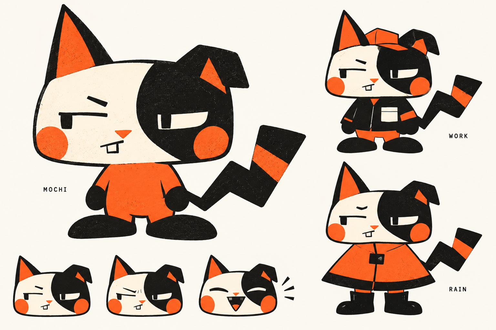

# 黑橘孔版怪趣 chibi 美術方向

使用者認為 v1 與 v2 仍有通用 AI 生成感。本次選定更受限制的圖像語言，先重設 MOCHI，沒有將其他三角色假稱為已完成新版。



## 造型規則

- 墨黑、螢光橘、米白三色。正式 sprite 不使用漸層、立體光澤或毛絨細節。
- 寬扁頭、小身體、短粗手腳，一隻尖耳加一隻折耳。折線尾巴與半臉深斑保留為主要識別。
- 狹長眼、偏斜眉、單顆方牙，表情帶一點嫌棄與怪趣。不用通用亮晶晶圓眼。
- 衣服以剪影變化為主。WORK 是方形工作外套，RAIN 是三角雨披；都保留臉、耳朵與尾巴識別。
- 紙紋與印刷顆粒僅用於概念展示。正式 64／96px 素材需降低或移除細顆粒，避免閃爍與髒邊。

## 設計狀態

使用者已明確接受本版風格，並要求延伸角色與服裝。圖中有 MOCHI 本體、工作服、雨披與三個表情，尚無透明分層或動畫。後續已擴充為六角色與十二套新服裝，見 [擴充目錄](../../pet-inkside-catalog-2026-10-28.md)。使用者接受的是風格方向，不代表後續所有角色與服裝已逐項定稿。

## 生成方式與提示詞

使用內建 image_gen，以全新文字描述生成，未引用 v1／v2 圖像，未使用 CLI 或環境 API Key。

```text
Use case: stylized-concept.
Create a radically distinctive ORIGINAL desktop pet art-direction sheet. This is a NEW design, not a continuation of any previous generic cute cat. Art direction: THREE-INK RISOGRAPH POSTER GRAPHICS meets eccentric compact CHIBI character design. Flat ink-black, fluorescent vermilion-orange, and warm offwhite ONLY. Absolutely no other colors. Bold graphic shapes, sophisticated indie comic/zine taste, deliberately odd and charismatic rather than conventionally adorable. Flat artwork, no rendered volume. Very sparse tiny screenprint ink speckle inside large shapes, sharp clean silhouette so usable at 96px.
Landscape sheet. Left 55 percent: one BIG unclothed mascot full body, with name "MOCHI" in small plain black typography. Right 45 percent: TWO smaller full-body outfit variants stacked with ample spacing, tiny labels "WORK" and "RAIN". At bottom left a strip of three tiny expressive head studies: deadpan, annoyed, delighted. Generous offwhite negative space. Only those 3 text labels. No title, no arrows, no diagrams, no marketing layout, no palette circles, no decorative stars.
DESIGN THE CAT THIS WAY:
1.5 heads tall, EXTREMELY WIDE squat almost rectangular head with just TWO huge angular ear shapes, one upright pointed ear and one visibly folded square-tipped ear. Tiny pear-shaped body, very short thick mitten arms and flat oversized bean feet. This is a weird urban pocket cat, not a fox, not a dog, no fur tufts, no plush animal aesthetic.
Face is MOSTLY a single offwhite flat plane with an asymmetrical massive INK-BLACK block covering the character's LEFT eye and left cheek. Eyes are narrow horizontal offwhite/black slots with simple SMALL VERTICAL RECTANGULAR pupils; NO big round anime eyes, NO iris, NO shiny pupils, NO highlights. One low crooked eyebrow makes a mildly unimpressed personality. Small orange inverted triangle nose. A short sideways mouth with ONE conspicuous squared tooth at one end. Cheeks are geometrically round, no fluffy outlines. ONE upright ear has a big orange inset. Body mostly solid orange with no shading. Paws solid black. Tail a giant blunt zigzag lightning shape curling to one side, solid black with ONE bold orange band. Strong asymmetry, very memorable angular tail. Avoid resemblance to any existing famous cartoon mascot.
WORK outfit: Same exact cat, face, proportions, eye mask, ears and tail. Black boxy cropped utility jacket with a single HUGE offwhite square chest pocket and orange sleeve stripe, a flat orange brimless work cap tipped sideways between ears. No little buttons, fabric folds, seams or badges.
RAIN outfit: Same exact cat. One oversized orange triangular rain poncho with a single large black center closure and black lower hem. Two ear openings, folded ear remains folded. Tiny solid black rain boots. Tail completely visible. Poncho makes an unmistakable triangular silhouette contrasting the bare cat's square head.
Use minimal selected thick contour lines only where needed; most edges defined by touching solid color shapes. Large flat shadows as black silhouettes only if structurally essential. No gradients, no soft lighting, no airbrush, no glossy 3D, no watercolor, no pastel, no fuzzy fur, no paws-with-pink-toebeans, no hearts, no conventional chibi anime merchandise style, no mobile game mascot polish. Slight controlled asymmetry in linework like a skilled independent illustrator's printed comic. No watermark. This must feel like an authored visual identity with strict shape grammar, NOT a generic AI pet character sheet.
```

