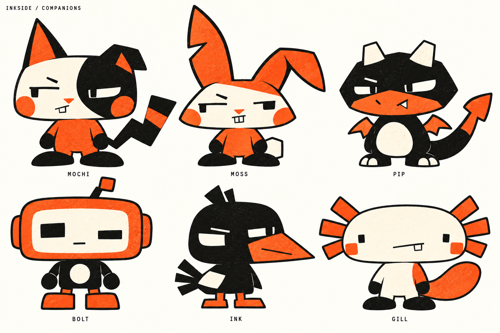
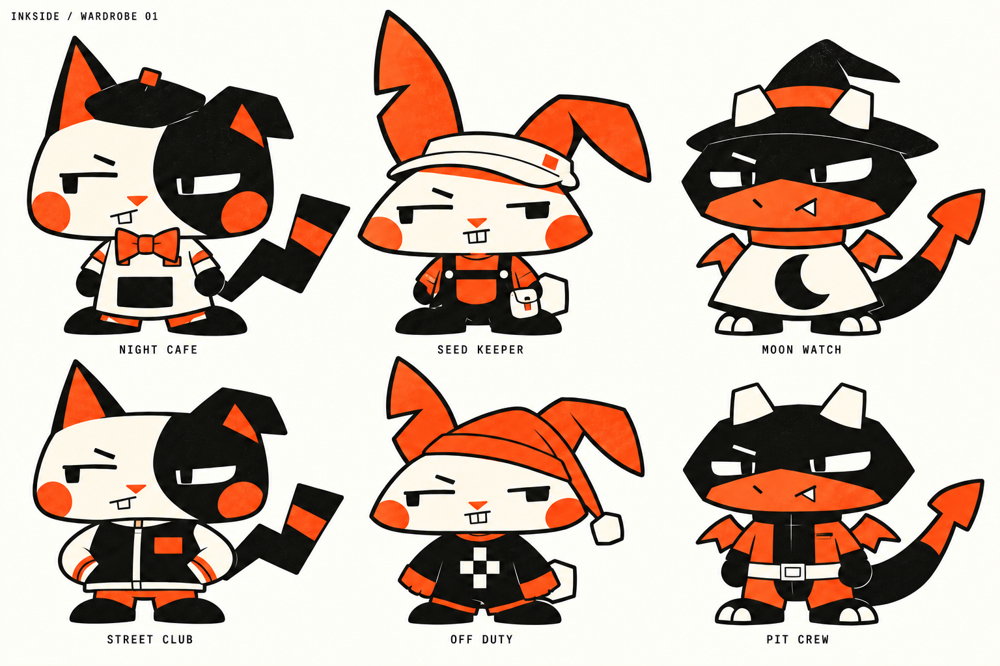
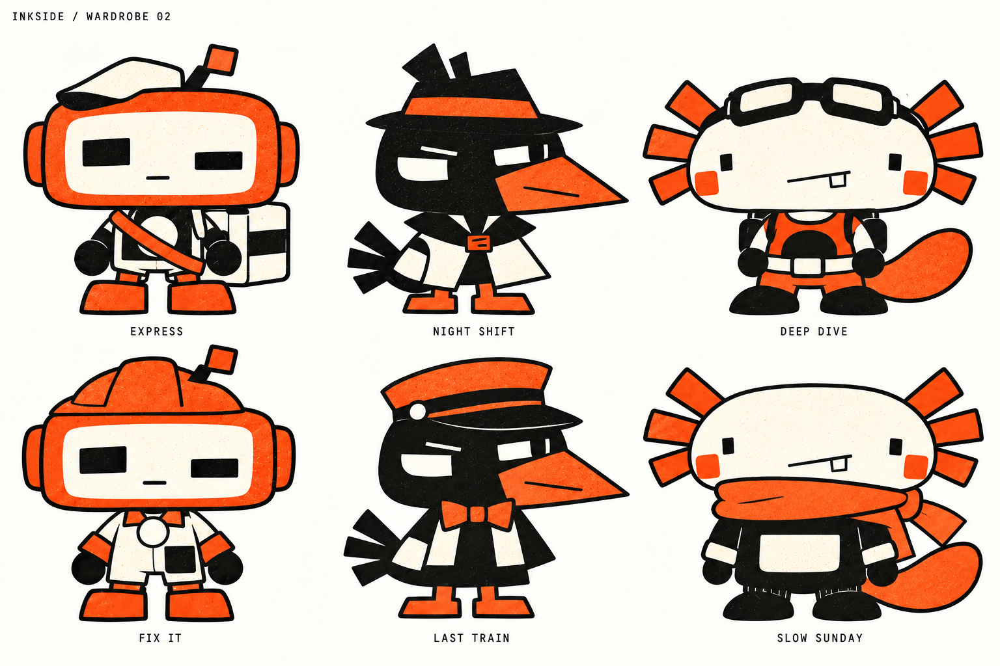

# 黑橘孔版 chibi 角色與服裝目錄

使用者已接受黑橘孔版印刷與怪趣 chibi 的風格方向。本次保留 MOCHI，增加五種角色，另製作十二套新服裝概念。加上原先 MOCHI 的 WORK 與 RAIN，目前共有十四套服裝構想。
這份目錄取代前兩版粉彩與多色 chibi 的美術方向。原本的互動、試穿、相容性與存檔規格仍適用。圖中 INKSIDE 為工作標題，沒有改動 FrontEngine 名稱。

## 六種角色

| 角色 | 外型識別 | 性格與動作提案 |
| --- | --- | --- |
| 麻糬 MOCHI | 寬扁頭、一尖一折耳、半臉深斑、折線尾巴 | 嘴上嫌棄但會陪你；摸摸先瞇眼，再慢慢甩尾 |
| 芽芽 MOSS | 一直一折的缺角長葉耳、梯形臉、雙門牙、方尾球 | 謹慎又愛操心；受驚時長耳立起，休息時折下 |
| 泡芙 PIP | 黑色六角頭、短米白角、橘大嘴、小翅膀與箭頭尾 | 自認威風的小龍；被誇時挺肚，失敗時別過臉 |
| 波特 BOLT | 橘框長方頭、不等大的螢幕眼、偏側天線、圓胸口 | 一本正經的助手；思考時眼睛左右移動，完成時抬手 |
| 墨墨 INK | 黑色方圓頭、橘楔形大喙、方羽尾、單側白翼斑 | 好奇又多疑；先歪頭觀察，再側步靠近 |
| 慢慢 GILL | 米白膠囊頭、左右各三支橘外鰓、方腮紅、橘槳尾 | 反應慢半拍；先停一下，再擺尾表示開心 |

名稱與個性屬設計提案。動作尚未製作；性格不應導致寵物拒絕使用者的基本操作。

## 十二套新服裝

| 角色 | 套裝 | 槽位拆分提案 | 必須保留 |
| --- | --- | --- | --- |
| MOCHI | 夜班咖啡 NIGHT CAFE | 頭部黑貝雷帽、頸部橘領結、身體米白圍裙與黑大口袋 | 折耳、半臉斑與尾巴 |
| MOCHI | 街角社團 STREET CLUB | 身體黑白棒球外套與橘短褲，固定橘大貼片 | 無帽，讓頭型與穿搭差異明顯 |
| MOSS | 種子管理員 SEED KEEPER | 頭部米白遮陽帽、身體黑吊帶服與橘口袋、背部兼腰側米白種子包 | 長耳完整露出，帽沿需分前後片 |
| MOSS | 下班睡衣 OFF DUTY | 頭部橘睡帽、身體黑睡衣與白幾何標記 | 睡帽不能固定住折耳；睡姿需另畫 |
| PIP | 月面觀測 MOON WATCH | 頭部黑尖帽、頸部橘領圈、身體米白大月形披風 | 雙角穿出、翼側開口、箭頭尾 |
| PIP | 維修車隊 PIT CREW | 身體橘工作連身服、黑中片與白寬腰帶，手套屬服裝部件 | 不戴頭盔；翅膀與尾根需開口 |

| 角色 | 套裝 | 槽位拆分提案 | 必須保留 |
| --- | --- | --- | --- |
| BOLT | 方盒快遞 EXPRESS | 頭部米白便帽、身體黑白背心與橘背帶、背部方盒包 | 天線與胸口顯示區不遮住 |
| BOLT | 修理一下 FIX IT | 頭部橘安全帽、身體米白維修服與黑大口袋 | 安全帽天線缺口；胸口圖示可辨 |
| INK | 午夜偵探 NIGHT SHIFT | 頭部黑禮帽與橘帶、身體米白短風衣與黑領片 | 喙、白翼斑與鳥足；不長出人類手臂 |
| INK | 末班列車 LAST TRAIN | 頭部橘列車帽、頸部橘領結、身體黑短披衣與米白領片 | 帽檐不蓋眼睛，翅膀仍可折展 |
| GILL | 淺海探班 DEEP DIVE | 頭部置頂黑護目鏡、身體橘潛水服與黑腹片、背部裝備包 | 六支外鰓及槳尾；不使用全罩頭盔 |
| GILL | 慢速週日 SLOW SUNDAY | 頸部橘大圍巾、身體黑寬毛衣與米白大口袋 | 圍巾置於外鰓下方，睡姿不穿入臉部 |

衣服部件屬未實作規格，概念圖尚未拆層。腰包先使用背部槽的體型專用附件，不為一件服裝增加整套新槽位。
原 MOCHI 的 WORK 工作服與 RAIN 雨披仍保留，見 [已接受的風格基準](assets/pet-concepts-2026-10-28/mochi-v3-ink-chibi.png)。本次十二套不重複計算這兩套。

## 統一規則與適配邊界

- 保持墨黑、橘、米白三色。不同個性以輪廓和表情區分，不靠增加顏色。
- 服裝以大面積明暗比例和外形改變辨識，減少扣子、縫線、徽章等小細節。
- 頭型與固有附肢是身分的一部分。帽子必須為耳、角、天線或外鰓留出空間。
- 分別建立貓、兔、龍、機器人、鳥、蠑螈六種體型相容規則。共用服裝名稱不代表共用一張服裝圖。
- 本體應在無衣服時保持完整。換裝後出現的領圈、背帶、帽沿與袖口必須屬於可卸下圖層。
- 鳥的袖口須跟翅膀動作，龍的背飾須避開翼根。蠑螈的外鰓屬本體，不能隨頭飾卸下。
- 概念圖採印刷顆粒；正式桌寵需先以無顆粒版本測 64／96／128px，再判斷是否保留低頻紋理。
- 左右不對稱臉斑、白翼斑與天線需要明確方向規則，避免整體翻轉造成身分標記跳邊。

## 製作順序

1. MOCHI 作第一個可動原型，用既有 WORK 與 RAIN 驗證方形外套與三角雨披的分層。
2. MOSS 驗證長耳帽沿遮擋，PIP 驗證翅膀與披風，再擴展多體型衣櫃。
3. BOLT 驗證剛性零件，INK 驗證鳥翼替代手臂，GILL 驗證外鰓及寬尾碰撞範圍。
4. 每種體型先驗證 idle／walk／sleep，再完成爬牆、拖曳、落下與直接互動。概念圖存在不代表所有動作已適配。

依 Experience First，先確認小尺寸下能看清角色，再投入動畫量產。依 Sequence work into verifiable units，六體型分批驗證，不一次製作十二套全動作後才測遮擋。

## 本次交付與驗證範圍

三張正式概念板均以內建 image_gen 製作，角色群像引用已接受的 MOCHI 基準，兩張服裝板引用同一群像。第一張服裝板修正了帽尖裁切，再保存最終稿。
完整提示詞與修正紀錄見 [生成紀錄](assets/pet-concepts-2026-10-28/prompts-inkside-expansion.md)。
已直接檢視三張圖，確認角色數量、服裝數量、三色方向及主要附肢可見；正式像素色表、逐幀一致性、縮小尺寸可讀性及動作遮擋仍需製作階段驗收。沒有修改寵物程式或真實存檔。
