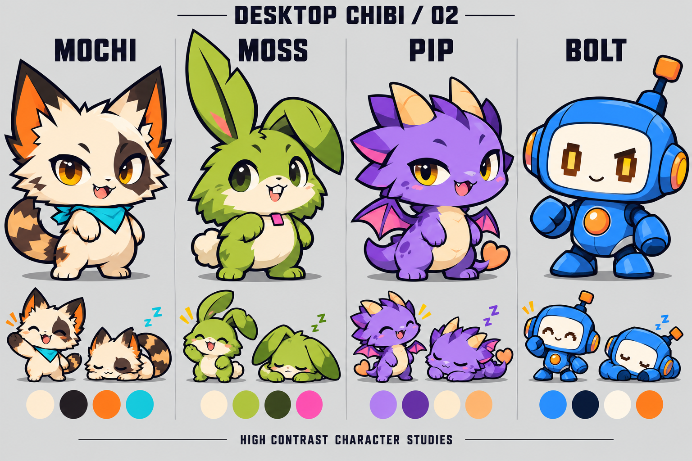
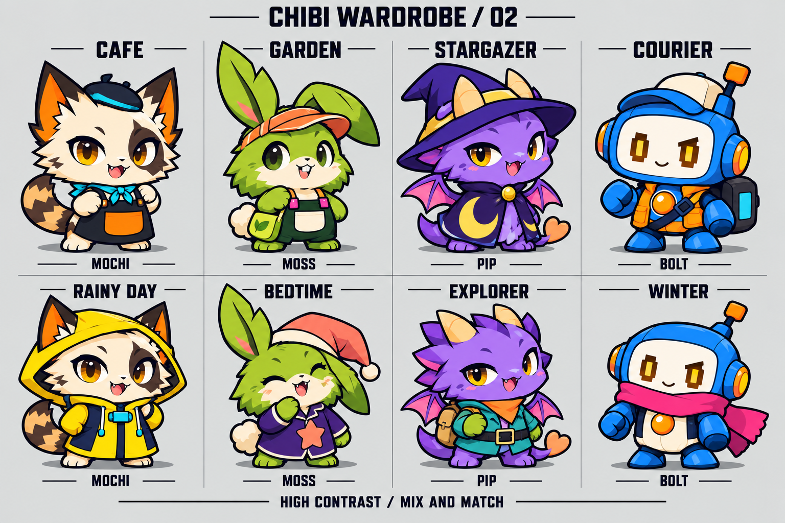

# 桌面寵物互動、換裝與高對比 chibi 設計規格

本文件是 2026-10-28 的產品與美術設計提案，補充原本的寵物強化及 Steam 素材計畫。功能尚未實作。
最新美術方向為使用者已接受的 [黑橘孔版印刷 × 怪趣 chibi](assets/pet-concepts-2026-10-28/style-v3.md)，採三色、寬扁頭、偏斜表情與強剪影。
新版已完成六角色、十二套新服裝，加上原 MOCHI 的工作服與雨披共十四套構想，詳見 [最新角色服裝目錄](pet-inkside-catalog-2026-10-28.md)。下文第 2 節四角色表與第 6 節八套服裝圖保留作舊版探索，不能當作最新美術基準。互動、養成、衣櫃、存檔規格繼續有效。概念圖不是遊戲素材或 Steam 實機截圖。

## 1. 產品體驗與範圍

使用者第一次開啟時可選寵物、命名、召喚，立即摸摸或餵食。之後可讓牠安靜陪工作、一起玩、換衣服，再把喜歡的搭配保存下來。
日常循環為「看見狀態 → 主動互動 → 看見反應 → 累積關係 → 選擇新穿搭」。使用者離開不受到死亡、失去服裝或連續登入中斷的懲罰。
工作模式不讀取使用者輸入內容。寵物不擅自打開、刪除、移動或上傳餵給牠的檔案。
完整設計涵蓋以下能力，不表示每項都屬於首個可交付版本。

| 領域 | 設計結果 | 現況與缺口 |
| --- | --- | --- |
| 身分 | 名字、個別狀態、外觀、穿搭、偏好與關係紀錄 | 已有 UUID 與基本狀態，新外觀欄位需遷移 |
| 接觸 | 輕點、撫摸、提起、拖曳、放下、招手 | 已有點擊與拖曳，需區分意圖及動作 |
| 照顧 | 餵食、休息、整理、簡短回應 | 已有飽足與心情，新增能量及整理動作是提案 |
| 玩耍 | 玩具、接球、追逐、雙寵互動 | 已有追逐與部分引導，玩具循環需逐項核實 |
| 陪伴 | 工作、玩耍、休息預設與專注回饋 | 既有打字安分與計時整合，不另造計時器 |
| 換裝 | 分槽試穿、混搭、取消、套用、保存套裝 | 現有 change_sprite 是整套替換，尚無分層衣櫃 |
| 創作 | 官方角色服裝、相容性檢查、包匯入匯出 | 已有六動作 Sprite 包工具，分層包需新增格式 |

## 2. 先前高對比 chibi 探索與待重設角色

角色採約 1.6 至 1.8 頭身，頭部佔站姿高度約六成。粗深色外輪廓、短四肢、大手腳，保留一眼可認的耳朵、尾巴、角或天線。
配色以一個主色、一個深陰影色、一個亮色與一個強調色構成。正式 sprite 使用大色塊與硬邊陰影，避免毛絨紋理、粉彩暈染、細碎花紋和過多高光。
概念圖仍含插畫細節，正式製作需簡化。以 64、96、128、192 實體像素預覽確認可讀性；96px 為主要桌寵尺寸目標，64px 必須仍可認出角色及套裝大類。
先比較深色、淺色及繁忙桌布。輪廓在深色桌布不清楚時可開啟低強度外緣光或接觸陰影，不直接提高整個角色透明度。
左右不對稱標記以角色自身的左右為準。若鏡像導致眼罩換邊不可接受，須提供兩個方向素材，不能把自動翻轉當成一致性證明。

| 角色 | 外型與識別點 | 個性與招牌動作 | 配色設計基準 |
| --- | --- | --- | --- |
| 麻糬 MOCHI | 奶油貓、大三角耳、左眼幾何深斑、閃電狀尾紋、青色領巾 | 好奇但會安靜，摸摸時瞇眼甩尾，吃完舔嘴 | 奶油、近黑、亮橘、青藍 |
| 芽芽 MOSS | 萊姆綠葉耳兔，一耳直立帶缺角、一耳折下，小方門牙 | 害羞、慢熟，聽到招呼耳朵抬起，開心時短跳 | 萊姆綠、墨綠、奶油、桃紅 |
| 泡芙 PIP | 紫色幼龍、大角、小翅膀、桃色愛心尾端 | 愛表現、反應誇張，受讚賞時展翅，休息時蜷尾 | 鮮紫、深紫、暖杏、亮桃紅 |
| 波特 BOLT | 鈷藍機器人、大方圓頭、偏側天線、橘色胸燈 | 俐落、好奇，揮手時眼睛變弧線，睡覺時顯示低亮呼吸圖示 | 鈷藍、深海軍藍、冰白、亮橘 |

個性改變台詞、動作權重及反應速度，不影響使用者取得功能的能力。BOLT 的補充能量可用虛構能量點心呈現，仍使用同一照顧系統。
以上名字是工作名稱，尚未做商標或市場重名查核。

## 3. 完整互動表

所有互動預設可無聲完成。音效、泡泡、動畫幅度與主動發話頻率分開設定。

| 使用者意圖 | 操作 | 寵物反應 | 狀態與限制 |
| --- | --- | --- | --- |
| 打招呼 | 左鍵按下再放開，未越過拖曳距離 | 看向使用者、眨眼或短揮手 | 不在 mousePress 立刻增加好感，避免拖曳也算摸摸 |
| 撫摸 | 互動選單選摸摸，在寵物局部區域來回移動 | 閉眼、耳朵或尾巴反應，短愛心 | 撫摸模式內暫停拖曳；離開、Esc 或選結束即可退出 |
| 提起移動 | 左鍵移動超過平台拖曳閾值 | 提起、腳懸空，衣服跟隨 | 結束撫摸後才能拖曳；不因每次 move 重複加好感 |
| 放下或拋出 | 釋放拖曳 | 短落下、落地回彈，再回原模式 | 允許停用拋擲；超出可見範圍需找回 |
| 叫牠過來 | 選單選過來，於自有操作層指定位置 | 走向目標後停下看使用者 | 可取消；不操作其他應用程式 |
| 餵食 | 選點心或拖檔案到寵物 | 聞聞、吃、吞嚥、回應 | 只讀取必要類型判斷，不開啟或刪除檔案；吃飽後不連續增加數值 |
| 表示偏好 | 提供不同虛構點心 | 喜歡時表情更明顯，不喜歡時溫和搖頭 | 偏好不阻止照顧；不將檔名或內容傳送外部 |
| 梳理 | 選整理毛毛／保養機身 | 梳毛或擦拭動畫、整理完伸展 | 簡短可跳過；不另增強制清潔負擔 |
| 休息 | 選休息或低能量時允許自動休息 | 打呵欠、蜷起、緩慢呼吸 | 使用者可喚醒；自動休息可關閉 |
| 玩球 | 選球，在寵物活動區投出 | 追球、碰球、回到附近 | 玩具屬自有覆蓋層，不搶鍵盤焦點；可隨時收起 |
| 逗逗牠 | 選逗貓棒／光點玩具 | 看向玩具、短撲或小跳 | 角色使用不同動作；限制活動距離，不遮整個桌面 |
| 雙寵追逐 | 選一起玩，選另一隻可用寵物 | 輪流追逐，結束後停下 | 沿用已有鬼抓人，休息或拖曳時退出配對 |
| 雙寵招呼 | 兩隻靠近且都允許社交 | 對看、揮手或短同步動作 | 同一對有冷卻，不無限觸發；不阻擋工作模式 |
| 陪工作 | 切工作模式或開始專注 | 移到安全位置，降低活動與主動發話 | 打字只偵測活動，不記錄文字；不可用的平台顯示限制 |
| 專注結束 | 既有計時器完成 | 短祝賀，再提供休息選項 | 不彈出搶焦點的對話框；同一計時完成只發獎勵一次 |
| 換裝 | 開衣櫃試穿並套用 | 試穿鏡頭轉身或揮手 | 試穿不保存、不加好感；套用才寫入裝備 |
| 拍照 | 選拍寵物 | 擺短姿勢，可保存透明角色圖 | 預設只輸出寵物自身畫面；拍整個桌面是另一個明確動作 |
| 晚安與回來 | 關閉或重新召喚該身分 | 簡短告別或招呼 | 不因離線變差；不自動喚起其他視窗 |

互動時間的初始提案為招呼 0.5 至 1 秒、餵食 1.5 至 2.5 秒、摸摸每段約 2 秒、整理約 3 秒。實作原型需依小尺寸觀感調整，不能直接當成已驗證參數。
單擊與雙擊不配置互相衝突的養成行為。右鍵提供一致選單；鍵盤可由寵物管理頁完成等效操作。點擊穿透時可從控制中心恢復互動。

## 4. 狀態、優先序與養成

| 狀態 | 範圍與變化 | 使用者可見結果 |
| --- | --- | --- |
| 心情 | 0 至 100，沿用既有概念；互動適量增加 | 表情、待機權重與簡短回應 |
| 飽足 | 0 至 100，沿用既有概念；吃點心補充 | 飽了溫和拒絕，不發生死亡 |
| 能量 | 新增提案，0 至 100；玩耍消耗、休息回復 | 低能量偏向坐下或睡覺，操作仍可用 |
| 好感 | 沿用既有數值，不直接改舊存檔門檻 | 解鎖打招呼變化、紀念動作及可選外觀 |
| 性格與偏好 | 角色預設加使用者選擇，獨立於基本數值 | 不同反應與習慣，不製造難養角色 |

工作、玩耍、休息是持續模式。摸摸、餵食、拖曳、換裝是暫時互動，結束後回到當前模式，而不是無條件回到行走。
事件優先序為關閉／素材錯誤處理，其次使用者直接操作，其次正在完成的短互動，其次模式行為，最後自主待機。重要操作可中斷低優先序動畫。
衣櫃預覽使用獨立預覽實例。桌面本體不因試穿而停止使用；套用時於安全動作邊界切換，最久等待時間需在原型量測。
互動獎勵由事件 ID 與冷卻管理。快速反覆點擊、換衣、開關衣櫃不能刷好感；純換裝不提供數值獎勵。專注獎勵不依靠修改系統時間重複領取。
進程分為熟悉、親近、默契等可理解階段。預設角色與基本服裝一開始可用，其餘透過累積互動或創作取得；沒有抽卡、付費貨幣、限時登入壓力或本次未要求的商城。
離線期間不扣狀態。初版不做複雜離線模擬，重新開啟可安排問候但不補算懲罰。
現有心情與飽足衰減掛在 chatter timer。新增模式前需對照開啟與關閉對話的實際行為，再讓狀態更新與泡泡顯示各自受控。

## 5. 衣櫃與換裝流程

衣櫃入口位於寵物互動選單與寵物管理頁。左側為寵物預覽，右側為裝備清單，下方固定顯示取消、套用與另存搭配。
衣櫃清楚顯示正在編輯哪一隻寵物，避免把 A 的穿搭套到 B。
標準流程為「開啟 → 選槽位或套裝 → 試穿 → 預覽動作 → 取消或套用 → 可選另存搭配」。

| 槽位 | 包含內容 | 衝突規則 |
| --- | --- | --- |
| 頭部 | 帽子、髮飾、睡帽 | 必須對應耳朵、角及天線；帽兜可能占用此槽 |
| 頸部 | 領巾、蝴蝶結、圍巾 | 上衣高領或披風可宣告占用；不任意堆疊 |
| 身體 | 上衣、圍裙、睡衣、雨衣、披風 | 一次一件；袖子、手套可作該件服裝的同步部件 |
| 背部 | 背包、毯卷、背飾 | 龍需要翅膀相容變體；不能遮掉翅膀而不提示 |

手持物先屬於短互動道具，不列為永久衣服槽。避免拿球、餵食與手持裝備同時爭用手部。
套裝是一組槽位選擇，不是特殊不可拆的物件。帽兜雨衣等整體裝備可同時占頭部與身體槽；套用前預覽將被替換的項目。
初版提供固定美術配色，不做任意染色。後續若增加配色，只開放已驗證的色票與可染區，避免把臉、眼睛或陰影一起染掉。
動作預覽至少包含站立、行走、睡覺、爬牆與餵食。衣服缺少必需動作時不可標成完全相容。
取消試穿完全恢復開啟衣櫃時的預覽組合，不寫入檔案。套用使用一次原子提交，失敗時桌面與存檔都保留舊組合。
換裝預覽允許暫時並排比較兩套，不增加桌面寵物身分。關閉衣櫃必須釋放預覽動畫與素材。
搭配名稱可修改，保存上限初始提案為每隻 20 套，達上限時明確提示，不默默刪除舊搭配。
素材遺失時保留裝備 ID 與意圖，顯示缺少項目，暫時使用基礎外觀；重新連結後才恢復。不能把缺素材當成使用者已卸下衣服。

## 6. 八套服裝構想與舊版視覺探索

以下為 v2 探索稿，使用者認為仍過於通用，已不作最新風格基準。服裝用途可沿用，但需按 v3 重設輪廓與三色配色，尚未分層、製作動作或驗證混搭。

| 套裝 | 首個適配角色 | 零件與大色塊 | 造型重點 |
| --- | --- | --- | --- |
| 深夜咖啡 CAFE | MOCHI | 近黑貝雷帽、青藍領結、黑圍裙、單一大橘口袋 | 耳朵完整露出；橘口袋在小尺寸仍可辨 |
| 霓綠園丁 GARDEN | MOSS | 亮橘遮陽帽、墨綠吊帶服、奶油口袋、桃紅扣片 | 葉耳穿出帽沿，吊帶不遮住大部分臉 |
| 月光觀測 STARGAZER | PIP | 深紫尖帽、金色寬帽帶、近黑披風、大金月圖形 | 角與翅膀外露；只留一個大圖形 |
| 閃送隊員 COURIER | BOLT | 冰白藍帽、亮橘工作背心、黑青背包 | 天線與胸燈保留，不畫細小工具 |
| 電光雨日 RAINY DAY | MOCHI | 亮黃帽兜雨衣、深藍側片、單一青藍扣具 | 帽兜與身體綁定占槽，尾巴自由活動 |
| 星眠時刻 BEDTIME | MOSS | 珊瑚睡帽、深茄紫睡衣、單一大珊瑚星 | 折耳不被睡帽固定，睡姿輪廓需另畫 |
| 青空探險 EXPLORER | PIP | 青綠短外套、橘領巾、深色腰帶、棕色背包 | 背包固定於翅根之間，手套若保留屬上衣部件 |
| 熱粉冬日 WINTER | BOLT | 大桃紅圍巾、冰白背心、深色側片 | 圍巾整體是一個大形狀，胸燈開孔 |

每套先適配表中的角色，再按需求製作其他體型版本。同一個服裝名稱不表示同一張 PNG 可以通用四種體型。
預計可混搭例子為 MOCHI 咖啡帽加雨衣身體，但帽兜需先關閉或改成無兜變體；否則顯示槽位衝突，不能直接疊兩頂帽。
角色圖中的小領巾或領標在正式素材中需要獨立成可卸下零件，不能烘焙在本體後又與新頸飾重疊。

## 7. 動作與美術交付

| 動作群 | 動作 | 首版要求 |
| --- | --- | --- |
| 舊包相容 | idle、walk、sleep、climb、fall、drag | 六種既有狀態持續可用，缺少時保留既有備援 |
| 直接互動 | greet、pet、eat、land | 首個完整角色具備，明確區分摸摸與提起 |
| 模式轉換 | sit、sleep_in、wake | 工作與休息轉換不突然換成錯姿態 |
| 展示 | outfit_show、celebrate | 可取消、短促，不影響主要操作 |
| 第二輪 | play、groom、peer_greet、catch | 基礎換裝與互動驗收後才擴充 |

正式分層角色採統一透明畫布與腳底基準。工作用畫布初始提案為 256×256，保留頭飾與尾巴空間；大翅膀或特殊體型需明確宣告範圍。
各動作提供幀數、每幀時長、循環方式、可中斷位置、錨點與遮擋層。站姿錨點不能直接套睡姿。
本體、頭飾、上衣、背飾由一個共用時鐘取幀，不讓每件衣服各啟動 QMovie。
固定排序不足以處理所有姿勢，需允許動作／幀指定前後片。例為背包後片在身體後、背帶在胸前、手在袖口前。
先合成完整寵物，再做整體翻轉、縮放及音量反應，避免帽子與本體各自計算造成漂移。
錨點只能解決位置，不會自動解決睡覺變形、耳朵遮擋或袖子變形；這些需要對應美術與遮罩。
每件正式服裝交付獨立 RGBA 圖層、適配角色與動作清單、縮圖、來源紀錄、授權及版本。概念板不能直接裁切當動畫層。
第一輪驗證量為一隻 MOCHI、頭飾加上衣兩件、idle／walk／sleep 三動作。測過同步、翻面與睡姿遮擋後，才擴為六基本動作與完整互動。
完整四角色八套的工作量取決於動作覆蓋與服裝適配，不能用八張立繪的產出時間估算整套動畫工期。

## 8. 資料與相容性設計

以下是建議資料責任，格式名稱與版本尚未實作，先在最小驗證確立後再固定 schema。

| 資料 | 責任與必要欄位 |
| --- | --- |
| CharacterDefinition | stable ID、body_template_id、基礎 palette、動作清單、錨點、可用互動及授權 |
| GarmentDefinition | stable ID、版本、占用槽位、相容體型、必需動作、前後圖層與衝突 |
| EquippedOutfit | 每槽 garment ID、已選色票、套裝名稱；不持有動畫時鐘 |
| PetIdentity | 原 UUID 與基本數值、角色引用、裝備組合、偏好與可選能量 |
| InteractionSession | 目前模式、暫時互動、目標、可中斷位置；不保存瞬間鼠標座標 |
| WardrobePreview | 原組合、候選組合、驗證結果；與正式身分隔離 |

現有存檔位於啟動目錄 `user_setting.json` 的 `pet_profiles` 欄位。以工作區啟動時為 `D:/Codes/FrontEngine/user_setting.json`，不同啟動目錄可能不同。此次檢查工作區檔案尚無 pet_profiles，不代表其他安裝目錄沒有存檔。
現有 checked_profile 嚴格限制欄位，不能直接添加 wardrobe。新版本需有明確 schemaVersion、舊存檔遷移、失敗復原與匯入驗證。
遷移保留 UUID、名字、心情、飽足與好感。新外觀使用資產 ID 與版本引用，缺少時給可恢復狀態，不寫死開發者的絕對路徑。
身分匯出預設只含狀態及資產引用，不自動打包付費或第三方角色檔。可攜角色包另走明確的資源與授權流程。
檔案寫入失敗、同身分重複啟用、兩隻同時換裝與預覽取消都需要獨立案例。保存與執行中的畫面不能一新一舊。
舊單張圖片、GIF/WebP、六動作 pet.json 包維持整套外觀替換。介面顯示它們不支援分件混搭，不偽裝已有服裝槽。
Puppet 使用原生模型宣告的 motion、expression、parameter 或服裝能力；目前未確認通用換裝 API。未提供換裝能力的模型不開放分層衣櫃，不能強行覆蓋 Sprite 衣服。
外部包只載入受驗證的資料與圖片，限制解壓路徑、大小、圖片尺寸、幀數及引用數量。匯入衣服不執行任意腳本。

## 9. 實作入口與風險

| 檔案或符號 | 實際現況 | 後續用途 |
| --- | --- | --- |
| desktop_pet.py / mousePressEvent | 按下即增加心情、好感並切 drag | 分離點擊、撫摸、拖曳意圖 |
| desktop_pet.py / change_sprite | 替換整套外觀並增加好感 | 保持舊路徑，純衣櫃不重複發獎勵 |
| desktop_pet.py / draw_content | 畫一張當前 pixmap，再整體變換 | 接入分層合成輸出，避免 renderer 承擔衣櫃保存 |
| pet_profiles.py / checked_profile | 嚴格基本欄位 | 引入版本遷移與引用驗證 |
| pet_profile_session.py / flush | 合併保存 mood/fullness/affection | 正式換裝使用可回復的提交流程 |
| utils/pet_pack/pack_builder.py | 六動作圖檔與簡單參數輸出 | 新分層格式獨立版本，不破壞舊匯出 |
| show/pet/puppet_pet.py | 原生動作、表情、點擊區與腳本 | 根據模型能力決定換裝入口 |

不要把所有新系統加進 desktop_pet.py。預計將純互動狀態、服裝相容性、資料校驗與畫面合成各自分工，具體模組邊界於原型後決定，不在本提案先鎖死函式簽名。
原生 Windows 視窗停靠、跨螢幕、混合 DPI、Puppet/OpenGL 需要隔離桌面驗證。全背景要求仍適用，不能為了錄製或驗收操作使用者前景。
3D 不是這輪換裝的必要前提。若後續增加 Tripo 模型，仍遵守插件登入、Studio 額度優先、原生分件與逐件貼圖、費用確認等既有指示。

## 10. 分階段交付與驗收

| 階段 | 範圍 | 完成證據 |
| --- | --- | --- |
| A 美術與動作基準 | 高對比 chibi、MOCHI 定稿、拆層與三動作小樣 | 96px 深淺桌布預覽；頭飾與上衣同步影片 |
| B 互動意圖 | 招呼、摸摸、拖曳、餵食、工作／玩耍／休息 | 事件表、實際操作短片、安靜模式不改狀態計時的對照 |
| C 衣櫃與保存 | 四槽試穿、取消、套用、搭配、遷移及缺資產處理 | 兩隻寵物獨立換裝、重開恢復、保存失敗復原 |
| D 完整首個角色 | MOCHI 兩套服裝、六基本動作與核心互動 | 全動作不漂移、不穿模的矩陣與可重拍樣片 |
| E 擴展角色與玩法 | 另外三角色、其餘六套、玩具與雙寵反應 | 每體型適配矩陣、來源清單、可見互動證據 |
| F 宣傳製作 | 把換裝與互動加入原 Steam 計畫 | 凍結版本實機影片與截圖，概念圖分開標示 |

原計畫的 8 至 12 工作天不適用於此擴大範圍。完成 A 的三動作分層樣本後，按實測每動作與每服裝適配成本重新估算；不先承諾四角色八套全動畫的日期。
回歸入口包含 `test_pet_logic.py`、`test_pet_drop.py`、`test_pet_profiles.py`、`test_pet_profile_sessions.py`、`test_pet_pack_editor.py` 與 `test_pet_settle_typing.py`。這次未執行測試，因為未修改程式。
新增驗收必須覆蓋以下行為。

1. 輕點、摸摸與拖曳各有不同反應，拖曳沒有額外累積點擊獎勵。
2. 帽子與上衣在走路、睡覺、翻面、爬牆、縮放及音量反應時同步。
3. 試穿不改正式外觀；取消無副作用；套用成功後重開恢復同一組合。
4. 兩隻同種角色可以穿不同衣服，UUID 與狀態不互相覆寫。
5. 缺素材、缺動作、錯體型、槽位衝突都有具體訊息，沒有默默穿錯衣服。
6. 舊存檔與舊寵物包仍可使用，Puppet 未支援能力不顯示為可用。
7. 反覆換衣不刷好感，衣櫃關閉後預覽 timer、素材與記憶體被釋放。
8. 能量低、工作中、睡覺與互動中斷都回到正確模式，不被舊 timer 拉走。
9. 純離屏與隔離原生桌面的證據分開保存，沒有前景搶占或宿主鍵鼠注入。
10. 在相同一隻及四隻寵物場景量測分層前後 CPU、記憶體及幀時間，依原計畫效能門檻檢查；未量測前不宣稱低耗能。

## 11. 宣傳片與截圖的更新方向

60 秒主片前段維持真實互動，加入「開衣櫃 → 點選帽子與衣服 → 套用 → 寵物穿著行走」的完整因果片段。不要只在剪輯中變裝，讓觀眾誤會沒有衣櫃操作。
八張截圖中增加一張衣櫃試穿、一張不同搭配的雙寵物，替換原先資訊重複的圖。高對比 chibi 的角色圖可供研發或幕後文章，不能冒充 Steam 遊戲截圖。
拍攝使用與交付版本一致的衣服、角色與動作。未完成的四角色八套只能寫成設計提案，不在商店宣稱已可使用。

## 12. 交付檔案與決策紀錄

- 最新風格圖為 [mochi-v3-ink-chibi.png](assets/pet-concepts-2026-10-28/mochi-v3-ink-chibi.png)，含 MOCHI 與兩套服裝。
- 新版規則及完整提示詞見 [style-v3.md](assets/pet-concepts-2026-10-28/style-v3.md)。
- 舊版四角色圖為 [characters-v2-chibi.png](assets/pet-concepts-2026-10-28/characters-v2-chibi.png)，舊版服裝圖為 [wardrobe-v2-chibi.png](assets/pet-concepts-2026-10-28/wardrobe-v2-chibi.png)。
- 內建 image_gen 的完整提示詞、參考關係與生成方式見 [prompts-v2.md](assets/pet-concepts-2026-10-28/prompts-v2.md)。
- `characters-v1.png` 與 `wardrobe-v1.png` 為已被使用者新方向取代的探索稿。

Experience First 使首輪聚焦可辨識的反應與可取消的試穿。Sequence work into verifiable units 使製作順序先驗證一個體型及三個動作，再擴展服裝與角色。Prove It Works 使概念圖、功能實作與原生驗收各自記錄，不互相代替。

## 13. 每隻寵物的高度自訂要求

使用者追加要求：每隻寵物都必須可高度自訂。MOCHI、MOSS、PIP、BOLT、INK、GILL 使用同一套編輯流程，各角色宣告自己的可用部位與相容資產。同種角色的不同個體也能保存完全不同的設定，不能只替 MOCHI 提供完整編輯器。

| 自訂範圍 | 使用者能調整的內容 | 保存與限制 |
| --- | --- | --- |
| 身分 | 名字、個體、複製個體 | 以 UUID 分開保存；複製後互不連動 |
| 身體外觀 | 主色、輔色、重點色、眼睛樣式、臉部表情及角色特有部位 | 配色以素材遮罩分區；不對整張圖套濾鏡，也不改掉黑色輪廓與紙白留白 |
| 服裝 | 頭、頸、身、背四槽；單件顏色；卸下或替換 | 各槽明確相容性；遮擋順序和動作錨點隨資產提供 |
| 搭配收藏 | 儲存、命名、更新、刪除、切換多套搭配 | 每個體各自保存，預覽取消不改正式搭配 |
| 行動習慣 | 大小、速度、地板行走／自由漫遊／追游標、爬牆、停窗邊 | 單隻覆寫或使用建立時的頁面設定 |
| 互動偏好 | 自動休息、允許拋擲、社交、對話泡泡、音量、打字時安靜 | 關閉偏好立即反映於行為；不能只是 UI 勾選 |
| 陪伴模式 | 工作、玩耍、休息；個別模式設定 | 切換模式與互動中斷由同一個狀態管理，重開保留選擇 |

維持已認可的黑／橘／紙白、高對比網印 chibi 語彙。配色提供符合這套風格的色票，再提供進階選色；輪廓、頭身比例與角色識別部位保留設計限制。自由度來自可組合的部件與行為，不靠無限制扭曲角色比例。

編輯器必須顯示該個體名字、即時預覽、套用、取消與恢復預設。外觀預覽能切換站立、走路、休息與左右朝向，套用前看得到服裝是否跟上動作。缺少素材時保留原引用並標示待修復，不靜默覆蓋使用者搭配。

目前已接通獨立偏好、分層衣櫃、搭配收藏、遮罩分區配色與素材宣告的五官／部件選擇。六角色正式五官部件、分層服裝與完整動畫，以及原生驗收仍待完成；測試色塊不算正式角色美術。

### 六角色部件製作清單

下表是待製作的角色素材選項；衣櫃已能切換素材宣告的部件，但這些正式美術尚未交付。每個角色都要有自己的部件，不能只把同一張臉套到不同身體。

| 角色 | 五官選項 | 固有部件選項 | 可調色區域與識別限制 |
| --- | --- | --- | --- |
| MOCHI | 細長眼／下垂眼／單眼挑眉；方牙／歪嘴／短線嘴 | 折耳角度、折線尾末端、半臉斑形狀 | 毛色、臉斑、內耳；保留寬頭、一尖一折耳與折線尾 |
| MOSS | 警覺眼／半閉眼／側望眼；並排門牙／錯位門牙 | 缺角葉耳、折耳方向、方尾球葉片 | 毛色、葉耳、鼻部；長葉耳與門牙仍可辨識 |
| PIP | 挑釁眼／困眼／驚訝眼；露齒大嘴／閉嘴 | 短角輪廓、小翼邊緣、箭頭尾端 | 腹部、口鼻、角與翼膜；保留六角頭與短胖身形 |
| BOLT | 不等大方眼／橫條眼／點陣眼；短線嘴／階梯嘴 | 側天線頂端、面框、胸口圖示 | 外殼、螢幕底色、燈號；保留長方頭與偏側天線 |
| INK | 側目／半閉眼／瞪眼；閉喙／微張喙 | 楔形喙長度、頭頂羽、方羽尾切口 | 喙、翼斑、眼周；保留鳥翼與鳥足，不改成人形手臂 |
| GILL | 小方眼／下垂眼／眨眼；平嘴／小開口嘴 | 外鰓末端、槳尾輪廓、方腮紅形狀 | 身體、外鰓、尾與腮紅；保留兩側各三支外鰓 |

眼型是外觀選擇；開心、睡眠、受驚等表情由動作驅動。每套眼型都要提供對應表情，不能因為選了半閉眼就失去眨眼或睡眠反應。耳、角、尾等替換件沿用角色骨架與錨點，換部件後需重新驗證帽子、背飾和全部動作。

黑橘紙白作預設色票。進階配色只改宣告的遮罩區域，黑色輪廓保留；在深色與淺色背景預覽實際對比。服裝顏色按單件保存，切換本體色不連帶改掉帽子或上衣。

### 每個角色的完成門檻

六個角色各自需要通過：同種雙寵不同五官與服裝、取消試穿、套用後重開恢復、搭配收藏還原部件及配色、資產遺失後修復、左右朝向和完整動作適配。每個角色至少用兩種五官組合與兩套服裝交叉檢查；不能用 MOCHI 的通過結果代替其他五種體型。

衣櫃依資產能力顯示可用部件。舊整張圖片仍能調整尺寸與行為，但需要製作分層素材才能逐件換五官或衣服。Puppet 依模型實際提供的參數開放選項。這些限制須在選擇素材時看得到。
