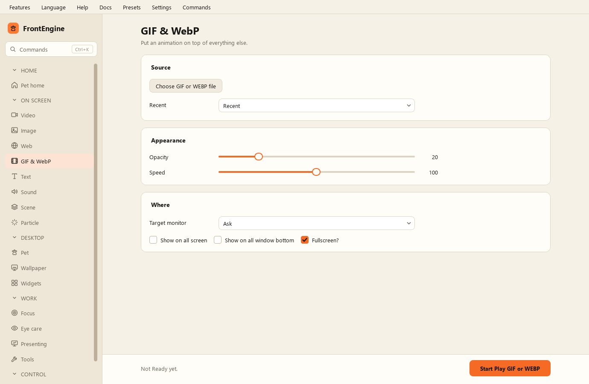

GIF- und WebP-Seite
-------------------

* GIF- oder WEBP-Datei wählen - die Animation.
* GIF oder WEBP abspielen - anzeigen.
* Deckkraft - wie durchsichtig sie ist.
* Geschwindigkeit - wie schnell sie läuft.
* Vollbild - auf den ganzen Bildschirm strecken.
* Auf allen Bildschirmen zeigen - eine Kopie je Monitor.
* Unter allen Fenstern zeigen - unter die anderen Fenster legen.
* Zielbildschirm - welcher Bildschirm; ohne Nachfrage standardmäßig der, auf dem FrontEngine ist.
* Zuletzt verwendet - vorher gezeigte Animationen.
