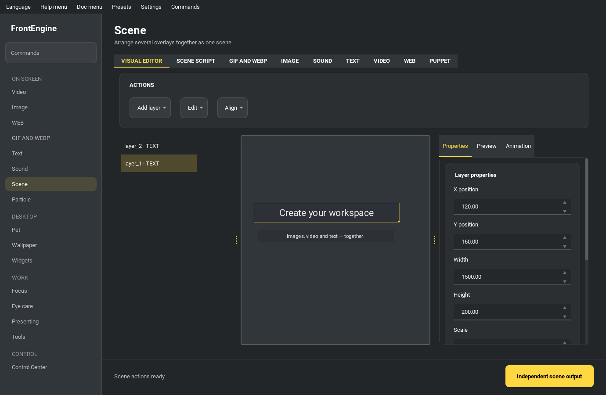

Scene Page
----------

A scene holds several overlays at once and can be saved to a file.

* Add web to scene - address and opacity.
* Add video to scene - file, opacity, play rate, volume.
* Add image to scene - file and opacity.
* Add gif to scene - file, opacity, speed.
* Add sound to scene - file and volume.
* Add text to scene - text, opacity, font size, alignment.
* Start scene - show everything that was added.
* output scene file - save what you built.
* load scene file - bring a saved scene back.
* clear all script - start again.
* Show on all screen - one copy per monitor.

Scenes: the Scene page accepts old entry-mapping JSON, a versioned frontengine.scene envelope, and portable .fescene packages. Add a PUPPET entry with position, size, opacity, finite numeric parameters, optional motion, expression and script. Paths in JSON resolve relative to the scene file. A .fescene includes the referenced media, original .puppet and optional .petscript.json so it can move between machines. Import checks paths, symlinks, versions and extraction limits. A FrontEngine scene remains a scene package; .puppet remains one Imervue character.

:doc:`runtime_interoperability`

Scene → Visual editor provides an image/GIF/text layer list and preview, group dragging, corner resizing, position/size/scale/rotation/order/opacity controls, canvas alignment, layout locking, visibility, duplication and 100-step undo/redo (Ctrl+Z/Ctrl+Y). Export portable .fescene packages directly; the Script tab also supports editing and applying JSON. Explicit dimensions, scale, rotation and visibility are restored during scene playback. Loading/applying external JSON starts a new undo history; existing scene fields remain intact.

Scene → Script → Scene templates (also in the command palette) provides Work desktop, Teaching and Focus starter layouts with localized editable text. Preview the layout and choose the primary or a numbered screen before Apply and play; proportions fit its available logical size. Templates include all required resources. Missing resources are listed with layer/field/path and block application. Applying replaces the editor and playback through the same scene candidate transaction; failed preparation preserves the old scene. Edit the resulting text, add media and use Scene output to save JSON or a portable .fescene. Closing the library cancels only its pending application. Focus includes editable reminder text; scheduling and timers remain separate tools.

Scene → Visual editor can add video, web, Puppet and audio alongside image/GIF/text. Enable live previews explicitly: at most eight sources, muted until Listen to selected media, paused when hidden, closed on disable or shutdown. Frames are bounded to 1280 pixels per side; unavailable sources show an error. Named scene playback composes video frames, the web renderer’s own surface and Imervue offscreen Puppet frames with all visual layers in z order; audio has no visible playback layer. Double-click a web/Puppet layer in playback or choose Interact with selected media in the editor to open its own native input window. Puppet preview needs native OpenGL and the optional runtime; preview does not execute pet scripts, and scene pets use temporary stats. Standalone web/video/Puppet windows remain available. JSON/.fescene export preserves every supported type and media reference.

Scene → Visual editor → Animation timeline edits x/y/opacity keyframes for one unlocked layer, with fade-in and slide-in starters. Times are unique and increasing, 0–3600 seconds, up to 128 frames per layer; opacity is 0–100, positions ±100000, easing linear or smooth. Empty cells leave that channel unchanged. Apply creates one undoable edit; JSON and portable .fescene retain animation tracks. Scrub, play, pause, resume or replay preview without saving temporary positions; Reset restores saved geometry before editing. Scene playback has separate animation controls and one shared monotonic clock across screens. Hidden views suspend it; explicit pause persists after showing. Media suspends during animation pause; replay controls animation tracks. Scene-action replacement dissolves an outgoing composed snapshot into the new scene over 0.5 seconds, releases old renderers immediately and starts the new timeline at zero. Legacy scenes without tracks remain compatible.

Scene → Independent scene output previews the current editor scene at fixed 640×480, 1280×720 or 1920×1080 pixels, independent of desktop position, occlusion and DPI. Start preview does not open a camera; Send to virtual camera explicitly uses optional pyvirtualcam and an installed compatible driver. Device startup/send/close runs on one worker with only the latest pending RGB frame; slow devices drop intermediate frames. Output is muted and carries no audio. IMAGE/GIF/TEXT and native VIDEO/WEB/PUPPET are composed in layer order; SOUND is invisible. Puppet requires its optional runtime and native OpenGL; unavailable media/device errors are displayed. Up to 256 layers, eight native media sources and 16 megapixels of total layer raster are supported. Stop, Escape, dialog/application close and editor changes dispose renderers and request camera closure; restart after scene edits. Closing old asset readers precedes scene-package lease release.

Windows builds share --preset and --debug with the Python CLI. For packaged native acceptance, install the optional frontengine[puppet] runtime in the build environment (Pillow decoder plugins and installed Imervue package data are included). Generate local synthetic fixtures with ``py tests/integration/scene_build_fixtures.py FIXTURES --puppet SAMPLE.puppet`` (fixture generation also needs PyAV). Run ``FrontEngine.exe --verify-scene-build FIXTURES REPORT``, choosing a new report directory and a native desktop. This fixed test isolates settings in a temporary directory, keeps previews muted, opens only its own scene/editor windows, verifies all seven types, legacy/versioned JSON, export/reload, GIF animation, web interaction, undo/redo, pause/resume and cleanup, then writes result.json and preview PNGs and exits. It executes no supplied Python test scripts. Inspect the report and exit code; unavailable runtime/native rendering fails explicitly.

3D scene editing and playback
=============================

Choose 3D in the existing visual editor. The layer list, JSON editor, undo/redo,
templates, screen selection and output dialog remain the entry points. Existing
media keeps its screen placement until explicitly changed to a world plane.
Converting back to 2D retains media and removes 3D objects/settings; Undo restores
the full 3D document.

Add GLB/glTF/OBJ models, planes, cubes, spheres, cameras, lights and groups. Model
nodes are inspectable but read-only. glTF supports core metallic-roughness
materials, skeletal and morph animation, and STEP/LINEAR/CUBICSPLINE sampling.
OBJ supports static geometry and basic MTL color/diffuse textures. Required
unsupported extensions fail explicitly. Draco, Meshopt, KTX2, shadows, physics
and mesh authoring are outside this implementation.

Select or drag with the left mouse button; Ctrl-click selects multiple objects.
Choose move/rotate/scale, axes and snapping in the toolbar, or drag a colored axis
handle. Scale uses local axes. Right drag changes the editor view, middle drag
pans and the wheel dollies. Focus selection helps inspect models with different
units. The editor view is independent of the playback camera; Use view as camera
explicitly updates the saved composition.

Edit numeric keyframes in the Animation inspector. Rotation is entered in degrees
and saved as quaternions. Choose a model animation clip, start, rate and looping.
The shared scene clock controls models, objects, cameras, lights, video, GIF and
audio. Web/Puppet are live sources: seeking cannot restore their historical state.
Previews are muted, native media previews require explicit enabling, and audition
only unmutes the selected source.

Desktop playback shares one clock and audio source across screens, fits the
canvas with letterboxing and supports click-through and the existing control
center. The exact candidate viewport is initialized and rendered before replacing
old playback. Failed or cancelled preparation preserves the current scene.

Disconnecting a target display closes only that display's viewport. The shared
clock pauses when no visible target remains; reconnecting the same display
recreates its viewport without restarting media or overriding an explicit pause.
Manually closed targets stay closed. Control-center quality and low-power settings
also apply to 3D previews, playback and output: lower quality reduces the internal
render resolution, while the output's selected pixel size stays fixed.

3D scenes use version 2 JSON or portable .fescene archives. Archives include model
buffers, MTL and textures and use the existing Workshop flow. Resources must stay
inside the model directory. Limits are 256 objects, eight native media sources,
eight lights, 256 MiB archives and a 512 MiB decoded model/raster budget.

Independent output renders a muted snapshot to an OpenGL framebuffer without
desktop capture. Camera output composites transparency onto a chosen RGB background,
black by default. Editing the scene stops old output; start preview again.
3D requires desktop OpenGL 3.3 and Auto/GPU rendering. 2D software fallback remains
available.

Run ``python -m pytest tests/unit_test/test_scene_3d.py tests/unit_test/test_scene_3d_ui.py``
for CPU/offscreen checks. Run ``python -m tests.integration.scene3d_gl_smoke`` on a
real desktop to verify transparency, skin/morph animation, transitions, editor
gizmos, candidate initialization and independent output. Offscreen unit tests do
not establish GPU compatibility.

For durable native evidence, run ``python -m tests.integration.scene3d_gl_smoke
--report REPORT`` with a new report directory. Add ``--media-fixtures FIXTURES``
for the seven-type fixtures described above, ``--camera`` for real OBS virtual
camera transmission and DirectShow pixel reception on Windows (requires PyAV,
pyvirtualcam and the installed driver), and ``--stress-vertices 250000`` for static
and animated skin/morph models. Missing runtimes or devices fail the requested
gate; omitted gates are reported as ``not_run``. Screen recreation is exercised
through simulated disconnect callbacks with real native viewports.

Build with ``python exe/build_exe.py --output-dir build/nuitka-scene3d --jobs 2`` and run
``FrontEngine.exe --verify-3d-scene-build REPORT --require-compiled`` with the same
optional flags to verify the actual binary. Its report includes an executable
SHA-256. A standalone build must retain its entire distribution folder.
The optional ``--jobs`` limit reduces concurrent compiler memory use.
On Linux, ``tests/integration/linux_scene3d_acceptance.sh`` runs the suite and a
native Xvfb/Mesa GL smoke in a disposable Debian/Python container with this
checkout mounted read-only at ``/workspace``. This verifies software Mesa GL,
and does not establish compatibility with every GPU or window compositor.

The supported Qt range is 6.11.2 to below 6.13. The optional Imervue runtime pins
Qt 6.11.2; install the Puppet extra before building a distribution that includes
Puppet. Python 3.14 executable builds require Nuitka 4.3.1 or newer.
