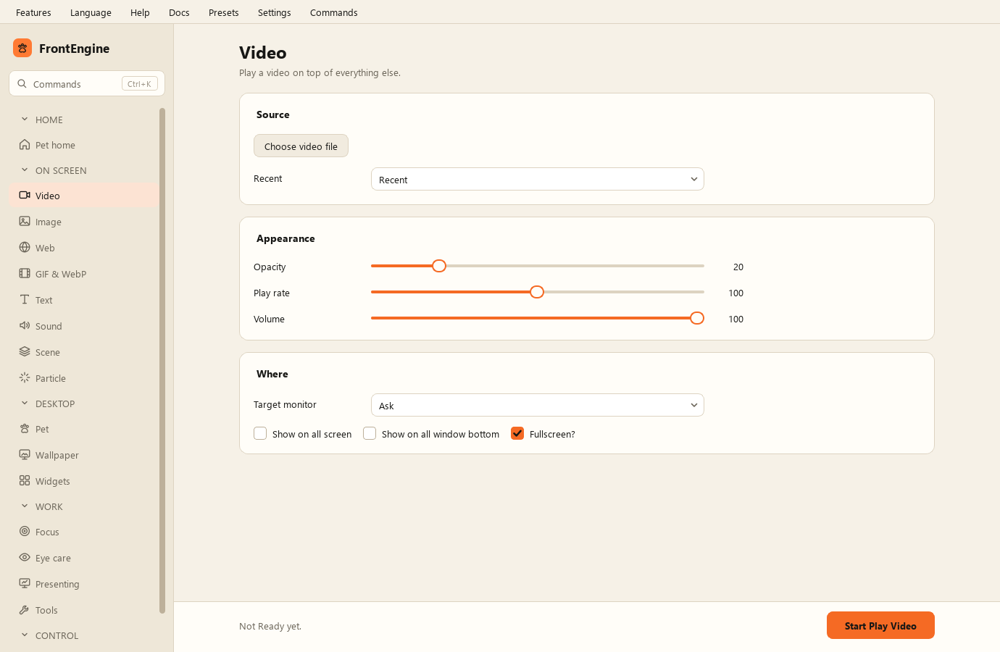

Pagina Video
------------

* Scegli file video - il file da riprodurre.
* Avvia il video - mostrarlo.
* Opacità - quanto il video è trasparente.
* Velocità di riproduzione.
* Volume.
* Schermo intero - allargare a tutto lo schermo.
* Mostra su tutti gli schermi - una copia per monitor.
* Mostra sotto tutte le finestre - collocarlo sotto le altre finestre.
* Schermo di destinazione - quale schermo usare; per impostazione predefinita quello di FrontEngine, senza chiedere.
* Recenti - i file già riprodotti.
