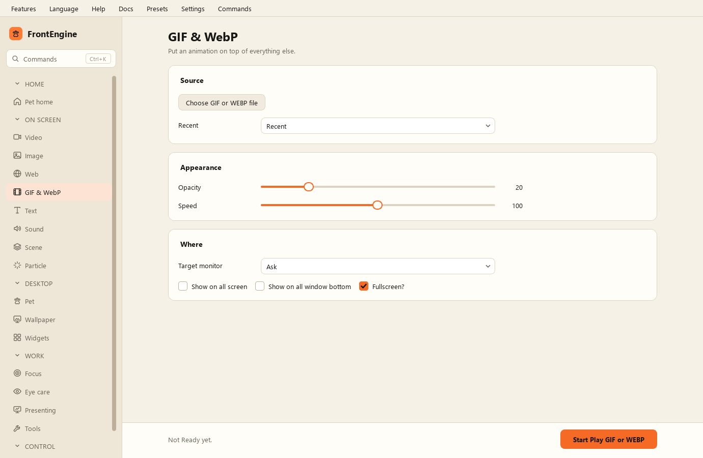

GIF и WebP
----------

* Выбрать файл GIF или WEBP - какую анимацию показать.
* Воспроизвести GIF или WEBP - показать её.
* Непрозрачность - насколько она просвечивает.
* Скорость - как быстро она идёт.
* Полный экран - растянуть на весь экран.
* Показывать на всех экранах - по копии на монитор.
* Показывать под всеми окнами - разместить ниже прочих окон.
* Целевой экран - какой экран использовать; по умолчанию тот, где открыт FrontEngine, без вопросов.
* Недавние - ранее показанные анимации.
