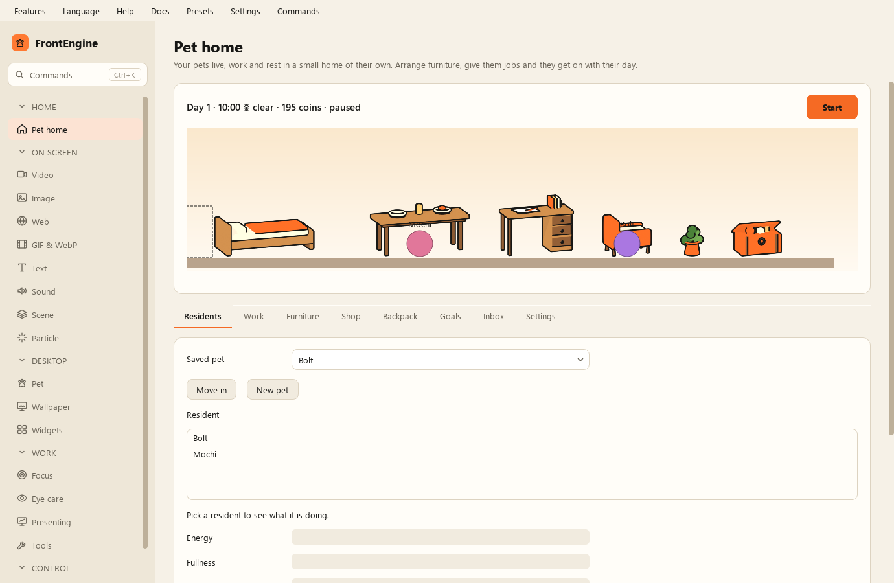

Как пользоваться
----------------

.. note::

    Поддерживается Python 3.11 и новее, кроме версий с 3.14.0 по 3.14.4. Для Python 3.14 используйте версию 3.14.5 или новее.

    На Windows с Python 3.14.4 воспроизведён сбой в нативном коде Qt; более ранние исправления ветки 3.14 исключены в качестве меры предосторожности. Пересоздайте существующие виртуальные окружения с совместимым интерпретатором и используйте его для запуска исходного кода. EXE со встроенной исключённой версией нужно пересобрать с совместимым интерпретатором. Обновление пакета FrontEngine не обновляет Python.

FrontEngine размещает поверх вашего экрана видео, изображение, веб-страницу,
текст, питомца - и держит их там, пока вы продолжаете работать. Каждое такое
называется слоем. Их можно держать сколько угодно одновременно, с разных
вкладок и на разных мониторах.

Первый слой
===========

1. В списке слева выберите страницу по тому, что нужно: видео, изображение,
   веб, текст и так далее.
2. Укажите файл или наберите адрес.
3. Нажмите внизу этой страницы кнопку запуска.

Слой появится поверх всего остального и останется там, пока вы его не закроете.
Ничто другое из того, что вы делаете, не уберёт его случайно.

Настройки, общие для всех вкладок
=================================

На большинстве вкладок стоят одни и те же несколько регуляторов, и означают они
везде одно и то же:

* **Непрозрачность** - насколько просвечивает рабочий стол. По умолчанию слои
  довольно прозрачны, чтобы лежать поверх работы, а не закрывать её.
* **Целевой экран** - какой монитор. *Этот экран* (по умолчанию) — тот, где окно
  FrontEngine; при запуске ничего не спрашивается.

  Если экранов больше одного, есть ещё **На все экраны**: один слой на весь
  рабочий стол, а не по одному на каждом экране.
* **Показывать на всех экранах** - по копии на каждый монитор, а не одну.
* **Показывать под всеми окнами** - увести слой под ваши окна, тогда он ведёт
  себя как задник, а не как что-то спереди.
* **Недавние** - ранее использованные файлы, чтобы не искать их снова.

Выбранный файл показывается сразу, как и перетащенный на страницу, а *Старт* без файла открывает выбор; пустое поле текста или адреса подсвечивается на месте вместо окна с предупреждением, и Enter в нём запускает.

Слои не мешают
==============

Щелчки проходят сквозь слой к тому, что под ним, поэтому нижнее окно работает
как обычно. Двум вещам мышь нужна по существу, и они исключения: питомец и слой
рисования на странице «Презентация», пока рисование включено.

Управление сразу несколькими
============================

Страница **Центр управления** дотягивается до каждого слоя, какой бы страницей он
ни был открыт. Можно разом скрыть их, выключить звук, заблокировать, вернуть на
исходные места или снизить качество, когда важна батарея. Чтобы перетащить один
из них, сначала разблокируйте - он запомнит, где вы его оставили.

Очистить экран
==============

«Закрыть всё» в Центре управления закрывает сразу всё, а в «Настройках»,
«Горячих клавишах» этому можно назначить глобальное сочетание. Если что-то
перестало отвечать, **F12** немедленно завершает FrontEngine.

Строка меню
===========

* **Выбор языка** - семь языков: English, 繁體中文, 简体中文, Deutsch, Русский,
  Français, Italiano. Интерфейс меняется сразу; перезапуск не нужен, и всё
  открытое остаётся открытым.

  При самом первом запуске, если Steam установлен и в нём выбран один из этих
  семи языков, FrontEngine запустится на нём, а не на английском. Это бывает
  один раз: после того как вы выберете язык здесь, действует ваш выбор. Steam
  читается локально - без учётной записи, без сети, ничего не отправляется.
* **Стиль интерфейса** - цветовая тема, при желании по расписанию день/ночь.
* **Пресеты** - сохранить под именем настройки всех вкладок и вернуть их
  позже. См. :doc:`menus`.
* **Настройки** - горячие клавиши, автозапуск, умная пауза, профили
  приложений, напоминания, режим витрины, пульт управления, приватность при
  показе экрана, экранное время и буфер обмена. Тоже :doc:`menus`.
* **Помощь** - «Как пользоваться…» открывает короткое руководство прямо в
  программе, о том же, что и эта страница. Там же трекер задач и напоминание
  про F12.
* **Документация** - открывает эту документацию в браузере.

Вкладки
=======

Показать что-то на экране

* :doc:`video`, :doc:`image`, :doc:`web`, :doc:`gif_and_webp`, :doc:`sound`,
  :doc:`text` - по одному виду на страницу.
* :doc:`scene` - несколько вместе, сохранённых в файл.
* :doc:`particle` - эффект частиц поверх рабочего стола.
* :doc:`pet` - спутник, который ходит, лазает и реагирует.

Чтобы работать удобнее

* :doc:`screen_care` - фильтр экрана, линейка для чтения, перерывы, цветовое
  зрение.
* :doc:`focus` - затемнить фон или закрыть отвлекающее.
* :doc:`wallpaper` - живые обои под всеми окнами.

Когда экран видят другие

* :doc:`presentation` - рисование, подсветка курсора, показ нажатий, лупа, доска.
* :doc:`tools` - измерение, снимок, чтение текста, запись, виртуальная камера,
  камера, закрепление окон.
* :doc:`widgets` - спектр звука, монитор системы, что играет, заметки.

И :doc:`control_center`, чтобы командовать всем этим сразу.

При смене языка интерфейса обновляются варианты целевого монитора и подсказка списка недавних файлов. Выбранные мониторы, имена и пути файлов и выбранные значения не изменяются. Это работает и после перезагрузки списка недавних файлов.
