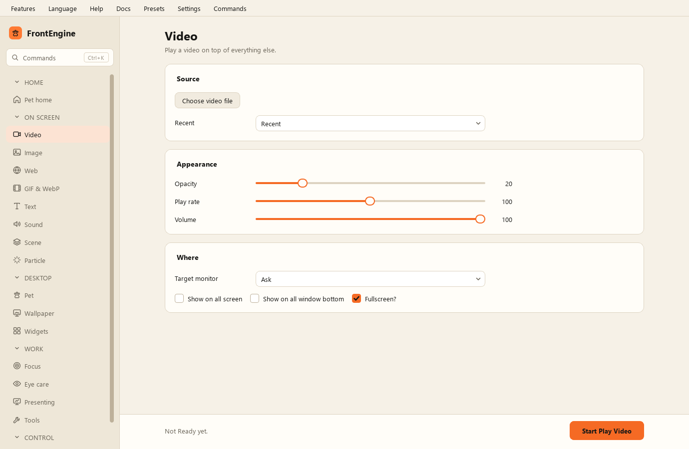

Видео
-----

* Выбрать видеофайл - какой файл проигрывать.
* Начать воспроизведение - показать его.
* Непрозрачность - насколько видео просвечивает.
* Скорость воспроизведения.
* Громкость.
* Полный экран - растянуть на весь экран.
* Показывать на всех экранах - по копии на монитор.
* Показывать под всеми окнами - разместить ниже прочих окон.
* Целевой экран - какой экран использовать; по умолчанию тот, где открыт FrontEngine, без вопросов.
* Недавние - файлы, которые вы уже проигрывали.
